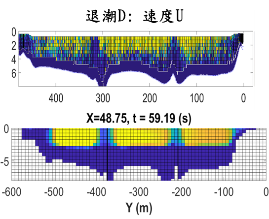
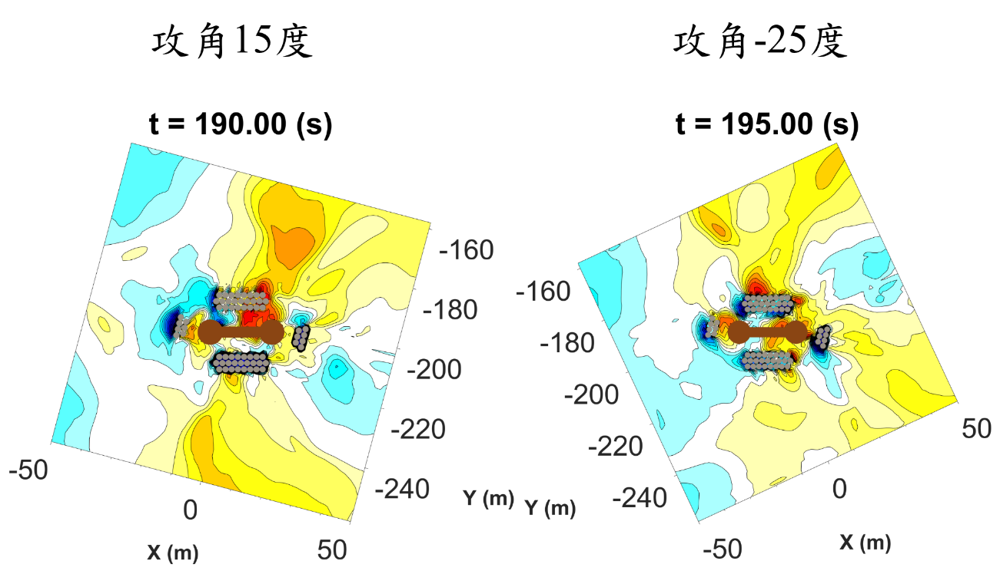
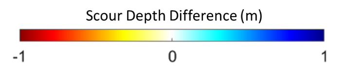

# Chapter 4 Guandu Bridge Flow and Local Scour

The Guandu application links measured tidal flow to local bed-response scenarios around foundations P5–P8. This chapter retains the distinction between a bathymetry-based fixed-bed model and separate idealized movable-bed domains. It quantifies the available velocity comparisons and examines where the local setup reproduces or misses surveyed morphology.

The DBM precedent of Vuong et al. (2024) concerns Shuang-Yuan Bridge. This chapter assesses Guandu-specific observations and scenarios, with site-informed tidal experiments (Yu et al., 2023) and geometry–hydrodynamics comparisons (Peng et al., 2026) providing external context.

## 4.1 Study site and observations

### 4.1.1 Bathymetry and coordinate systems

The modeling dataset combines riverbed point-cloud measurements acquired in November 2022, velocity observations supplied by the National Taiwan Ocean University team, bed samples collected in October 2022, and foundation geometry. Additional bathymetric comparisons cover 2013–2022 and 2022–2025. These periods are kept separate because their differences represent distinct histories of erosion, deposition, and possible maintenance.

The collaborative project defines a common horizontal frame with the origin at P8 and axes aligned parallel and perpendicular to the foundation direction. Data are translated and rotated into that frame and subsequently into the computational frame. Velocity vectors are transformed with the same rotations as position coordinates. In the fixed-bed model the inlet and outlet follow the chosen computational orientation. In the local model, x is the nominal approach-flow direction and the foundation is rotated relative to that direction to impose the attack angle. These transformations avoid interpreting a change of coordinates as a change in flow physics.

The reach model retains measured bathymetry. The local movable-bed experiments instead start from a flat bed at z = −5 m and a water surface at z = 0 m. The flat bed provides a consistent datum for scenario comparisons, but it omits bank shape, existing scour holes, and spatial sediment variability. Consequently, local results represent additional scour within an idealized configuration rather than a direct continuation of the surveyed bed.

### 4.1.2 Velocity measurements

Section measurements were collected on 1 March 2023 at five transects denoted A, B, C2, D, and E. Their nominal positions span approximately 100 m upstream to 100 m downstream of the foundations, with intermediate sections at 50 m and near the bridge. The measured east and north velocity components are rotated to obtain the streamwise component U used in the comparison. Instrument limitations leave gaps near the bed. Point measurements on 27 March 2023 supplement this region, with reported near-bed speeds of approximately 0.14–0.30 m/s during ebb and 0.24–0.35 m/s during flood.

Ebb observations show faster shallow flow, slower deep flow, and reduced velocities behind the foundations. Flood observations are more complex: some sections contain downstream-directed shallow flow and upstream-directed deeper flow. The transition between these directions includes a relatively slow intermediate layer. Surface-drifter records comprise five ebb tracks and two flood tracks. They provide a qualitative check on horizontal pathways rather than a measurement of the near-bed forcing responsible for scour.

### 4.1.3 Sediment measurements

A rotational viscometer was used to measure the relationship among apparent viscosity, shear rate, and derived shear stress for the collected bed material. The project identifies a threshold rate γ̇_y = 0.53 s⁻¹, a yielded-branch viscosity μ_B = 120.08 Pa s, and a stress intercept τ₀ = 63.64 Pa. The high-viscosity branch μ_A is described as large, but its numerical value is not specified in the report text. The measured sample provides a basis for the constitutive parameterization, while uncertainty remains concerning preparation, water content, repeatability, and spatial representativeness.

The simulations therefore treat the fitted parameter set as a material model to be assessed at the site. They do not assume that one sample captures all bed layers or that the yield threshold alone determines erosion. The 2025 scenario comparison includes a threshold-rate sensitivity experiment, described below, to examine part of this uncertainty.

## 4.2 Numerical methods

### 4.2.1 Hydrodynamics and rheology

The model uses the laboratory-developed Splash3D framework, derived from Truchas, to solve three-dimensional incompressible flow. Finite-volume discretization is combined with volume-of-fluid tracking of the material interfaces (Hirt and Nichols, 1981). The project formulation includes large-eddy simulation with a Smagorinsky closure (Smagorinsky, 1963). The governing equations can be written as

$$
∇·u = 0,
$$

$$
∂(ρu)/∂t + ∇·(ρu⊗u) = −∇p + ∇·[2(μ_r + μ_t)S] + ρg,
$$

$$
∂fₘ/∂t + ∇·(fₘu) = 0.
$$

The symbols denote velocity u, pressure p, mixture density ρ, gravitational acceleration g, strain-rate tensor S = (∇u + ∇uᵀ)/2, rheological viscosity μ_r, turbulent viscosity μ_t, and material fraction fₘ. The scalar rate is defined here as γ̇ = √(2S:S). The convention must match the parameter implementation when comparing measured and numerical rates.

Mobile sediment is represented by the discontinuous bi-viscous model, abbreviated DBM. Below the threshold rate the material has viscosity μ_A. Above it, the yielded branch has viscosity μ_B + τ₀/γ̇. The high-viscosity branch approximates strongly resistant material using a finite numerical viscosity. It permits small deformation and should not be described as an exact rigid solid. Implicit viscous treatment avoids the particularly restrictive explicit diffusion time step associated with large viscosity. The modified bi-viscosity predecessor and implicit viscous treatment are described by Wu et al. (2020); the later DBM branch definition is stated explicitly in Eq. (5) of Vuong et al. (2024). These references establish the numerical formulation, while the Guandu parameter values come from the supplied project measurements.

The value of μ_A should be varied separately from the measured yielded-branch parameters. Such a check would test the numerical resistance approximation for the present site; successful parameter choices in an earlier landslide or pipeline case are not a substitute.

This continuum approach does not resolve individual grains, aggregate break-up, or stone displacement. Its advantage is a direct material-stress representation within the multiphase flow solver. Its suitability for the present bed is assessed through field flow comparisons and the resulting spatial bed-change patterns. A reduction in the number of empirical transport coefficients does not eliminate constitutive or numerical uncertainty.

### 4.2.2 Fixed-bed configurations

The documented ebb domain extends from x = −100 to 150 m, y = −700 to 100 m, and z = −15 to 5 m. The selected grid has 100 × 100 × 40 cells and spacings of 2.5, 8.0, and 0.5 m. The bottom is no-slip, the lateral walls are free-slip, the top is open with zero prescribed pressure, and the outflow uses a hydrostatic-pressure condition. Vertical refinements of 1.0, 0.5, 0.25, and 0.2 m were examined in the presentation record. The report describes little additional improvement below 0.5 m, but a complete grid-convergence uncertainty estimate is not available.

For ebb, a uniform boundary using the section-A mean fails to reproduce the observed vertical contrast and weakens the foundation-shadow regions. The adopted boundary separates the upper and lower flow at 3 m below the surface. The documented velocity vectors are (0.7423, −0.2409, −0.0211) m/s in the shallow layer and (0.2844, −0.0984, −0.0030) m/s in the deeper layer. These values represent selected spatial averages at the boundary, not a resolved inflow turbulence field.

For flood, successive uniform and two-layer tests do not reproduce the full counterflow structure. The adopted configuration uses three layers at section E together with a section-A boundary contribution. The E-layer vectors reported in the examination presentation are (0.1789, −0.0542, −0.0298), (0.0024, −0.0201, −0.0178), and (−0.3690, 0.0219, −0.0263) m/s. The section-A vector is (−0.1724, 0.0325, −0.0043) m/s. Exact boundary assignment and the flood-domain x extent must be checked against the final inputs because the report's extent, cell count, and stated spacing are internally inconsistent.

### 4.2.3 Local movable-bed experiments

Separate local domains are constructed for P5–P8. The documented x limits are −150 to 150 m and the vertical limits are −15 to 5 m; the transverse span is approximately 200 m around each foundation. The bed starts at −5 m. A prescribed-velocity inlet, hydrostatic-pressure outlet, open upper boundary, no-slip bottom, and free-slip sides define the local experiment. Twenty-metre control regions near the inflow and outflow and a velocity ramp over the first 50 s are used to stabilize startup. Final mesh counts, numerical tolerances, and run durations remain essential configuration information to recover from the original input files.

The initial P7 experiments compare U = 0.34 and 5.0 m/s over a range of attack angles. Further angle tests identify +15° and −25° as useful representatives of different surveyed erosion and deposition patterns. These are selected scenario angles rather than independently measured directions of two historical floods. The selected angles are then applied to P5–P8 at U = 5, 6, and 8 m/s.

The project associates 5 and 6 m/s with earlier 20-year and 200-year design-flow assessments. Those associations are inherited from the cited engineering assessment, not estimated anew from the present simulations. The 8 m/s case is an additional extreme forcing scenario motivated by prior bridge-failure modeling. No recurrence probability is assigned to it at Guandu Bridge.

Existing P7 riprap is represented as fixed solid geometry and compared with a configuration without that geometry. The resulting differences diagnose flow redistribution around the prescribed protection footprint. They do not evaluate stone mobility, permeability, filter loss, or the probability of armour failure.

### 4.2.4 Comparison measures

The report provides measured and simulated layer-mean U values for ten ebb and fifteen flood section–layer combinations. We transcribe those pairs and calculate mean absolute error, root-mean-square error, and mean signed difference, with the difference defined as simulated minus measured velocity. Each reported section–layer pair receives equal weight. These statistics consequently summarize aggregated values and do not represent area-weighted or pointwise field error.

We report the complete sets and comparisons excluding sections used for boundary specification. For ebb, section A is excluded from the latter calculation. For flood, sections A and E are excluded. The remaining sections still belong to the same campaign used to develop the setup, so this separation improves interpretability but does not constitute an independent validation campaign.

Scour is reported using the positive additional depth d_s = z_b,0 − z_b,min, where z_b,0 = −5 m. Bed elevation z_b,min is retained separately when needed. Historical survey differences are compared spatially with model bed change. They are not treated as event-matched measurements of maximum transient scour.

## 4.3 Results

### 4.3.1 Fixed-bed flow assessment

The layered ebb boundary reproduces the principal shallow–deep velocity contrast and reduced streamwise velocity behind the foundations (Fig. 4.1). Across all ten layer means, MAE is 0.0291 m/s and RMSE is 0.0381 m/s. Excluding section A gives MAE = 0.0359 m/s and RMSE = 0.0426 m/s for eight comparisons (Table 4.1). The positive mean difference indicates an overall tendency to overpredict U in this aggregated comparison. The largest difference is 0.0677 m/s in the deeper C2 layer.

Flood results reproduce part of the measured counterflow structure but show larger discrepancies (Fig. 4.2). Across all fifteen pairs, MAE is 0.0787 m/s and RMSE is 0.1022 m/s. The largest difference is 0.2652 m/s in the deep section-A layer. Excluding A and E reduces the comparison to nine pairs, with MAE = 0.0525 m/s and RMSE = 0.0632 m/s. All nine signed differences are non-negative, indicating a systematic positive-U bias in these interior layer means. The model is therefore more successful at reproducing the broad ebb pattern than at matching the full flood-tide structure.

The surface-drifter comparisons show broadly similar pathways to the modeled streamlines. Ebb pathways are relatively stable, whereas flood pathways continue to change during the calculation. This difference is consistent with the more complex flood velocity field. A streamline comparison cannot quantify trajectory error in an unsteady flow without a matched time-dependent particle calculation.

Table 4.1. Recalculated differences between reported layer-mean streamwise velocities. Units are m/s except n.

| Tidal phase and comparison set | n | MAE | RMSE | Mean difference | Maximum absolute difference |
| --- | ---: | ---: | ---: | ---: | ---: |
| Ebb all sections | 10 | 0.0291 | 0.0381 | 0.0203 | 0.0677 |
| Ebb excluding A | 8 | 0.0359 | 0.0426 | 0.0258 | 0.0677 |
| Flood all sections | 15 | 0.0787 | 0.1022 | 0.0583 | 0.2652 |
| Flood excluding A and E | 9 | 0.0525 | 0.0632 | 0.0525 | 0.1060 |

### 4.3.2 Attack angle and historical bed change

For P7, the two selected angles reproduce different parts of the 2013–2022 spatial pattern. The +15° case better represents one combination of erosion and deposition, while the −25° case reproduces another erosion band. Their complementary behavior supports sensitivity to approach direction. It does not prove that exactly two events or these precise angles generated the historical morphology.

At P6 and P7, modeled additional scour of order 1–2 m at U = 5 m/s resembles parts of the surveyed bed change. At P8, the +15° case captures an erosion band and deposition toward the channel-facing side, while some upstream deposition observed in the survey is absent from the corresponding model pattern. Recovery after a flood could contribute to this difference, but the available comparison does not identify its cause uniquely.

P5 presents a clearer quantitative limitation. The historical survey indicates local changes of approximately 4–5 m, whereas the corresponding idealized simulations produce approximately 1–2 m of additional scour at U = 5 m/s. Its bank-adjacent position and possible sediment differences provide plausible explanations, but they were not isolated by controlled experiments. The discrepancy should therefore be retained as evidence that the flat-bed, shared-material approximation has limited transferability across the site.

### 4.3.3 Velocity sensitivity at P5 to P8

The detailed summary table gives additional scour depths of 1.36–2.17 m at U = 5 m/s and 1.95–2.71 m at U = 6 m/s (Table 4.2). The 8 m/s cases reach 4.41–5.75 m. These exact ranges are wider than the rounded ranges used in the report narrative. In particular, the extreme-scenario lower bound is 4.41 m rather than 4.5 m when all tabulated cases are included.

P7 and P8 generally develop deeper scour than P5 and P6 in the selected idealized cases. At +15° and U = 8 m/s, the additional depths are 5.47 and 5.51 m for P7 and P8, compared with 4.62 and 4.53 m for P5 and P6. At −25°, the largest depth is 5.75 m at P8, corresponding to a minimum bed elevation of −10.75 m. P5 reaches 5.05 m, while P6 reaches 4.41 m. The response to angle thus depends on the foundation configuration.

For all eight angle–foundation combinations, the increment in additional scour between 6 and 8 m/s exceeds the increment between 5 and 6 m/s. Because the velocity intervals differ and the experiment uses a particular ramp and finite duration, this observation does not identify a universal scaling exponent. It does show that modest extrapolation from the two lower-velocity scenarios would understate the changes produced by the extreme forcing in this model.

Table 4.2. Maximum additional scour below the initial bed at z = −5 m. Values follow the detailed summary table; the P5 −25° value at 6 m/s differs from one narrative passage and requires final input/output confirmation.

| Foundation | Angle degrees | U 5 m/s depth m | U 6 m/s depth m | U 8 m/s depth m |
| --- | ---: | ---: | ---: | ---: |
| P5 | +15 | 1.36 | 1.95 | 4.62 |
| P6 | +15 | 1.40 | 1.98 | 4.53 |
| P7 | +15 | 1.98 | 2.64 | 5.47 |
| P8 | +15 | 1.92 | 2.61 | 5.51 |
| P5 | −25 | 1.61 | 1.98 | 5.05 |
| P6 | −25 | 1.66 | 1.97 | 4.41 |
| P7 | −25 | 1.94 | 2.43 | 5.42 |
| P8 | −25 | 2.17 | 2.71 | 5.75 |

### 4.3.4 Transient development under extreme forcing

The extreme scenarios initially show little bed change. Upstream scour becomes apparent near 40 s while the imposed velocity approaches its target over the first 50 s. By approximately 100 s, bed elevations around the foundations commonly reach −6 to −7 m. A transverse band of erosion subsequently travels downstream and passes the foundation region during approximately 200–300 s in several cases. Strongly curved near-foundation streamlines coincide spatially with the deeper holes.

Many reported maxima occur near 260 s, but this timing is not universal. P7 at −25° reaches its largest additional depth, 5.42 m, near 160 s; its later value near 260 s is smaller. P8 at −25° reaches its reported maximum near 270 s. These differences show why a common final snapshot is insufficient to identify the maximum over the complete run.

The traveling erosion band may reflect a transient generated by the imposed ramp and boundary configuration. The present evidence does not establish that it represents a measured flood front. A ramp-duration sensitivity test, a longer upstream domain, and time histories of flow and bed stress are needed before assigning a field mechanism to this feature.

### 4.3.5 Protection geometry and updated survey comparison

Adding the fixed P7 riprap geometry reduces some flow through the middle of the foundation but does not consistently protect the upstream column regions. At U = 6 m/s, the reported difference maps show local increases in scour of approximately 0.5–0.8 m near those regions (Fig. 4.3). The result indicates that blocking one pathway can redirect flow toward another vulnerable area. It does not imply that riprap generally aggravates scour or that a different protection layout would have the same effect.

The 2022–2025 survey comparison is examined separately at P7. A 12-case sensitivity set combines γ̇_y = 0.1, 0.53, 2.5, and 12.5 s⁻¹ with U = 1.0, 2.5, and 5.0 m/s at +15°. A subsequent case at U = 1.5 m/s with γ̇_y = 0.53 s⁻¹ most closely matches the reported spatial trend. This represents calibration to the more recent bed-change pattern. Retaining the same threshold as the earlier sample parameterization is consistent with that scenario, but it does not demonstrate unchanged bed properties throughout the site.

## 4.4 Discussion

### 4.4.1 Boundary realism and the meaning of validation

The fixed-bed comparison demonstrates the value of preserving measured vertical structure in the prescribed approach flow. A uniform mean removes the upper–lower contrast during ebb and cannot reproduce the layered reversal during flood. The improvement from layering is therefore physically interpretable: the boundary retains features present in the measurements that are lost during averaging.

The quantitative assessment is more qualified than a general claim of excellent agreement. Boundary-section agreement is partly imposed. Interior flood comparisons retain a positive-U bias, and the section-A deep-layer difference is substantial relative to the observed velocity. Moreover, averaging can conceal local errors of opposite signs. The reported MAE and RMSE should be supplemented by collocated profiles, measurement uncertainties, and field-based spatial error measures before they are used to establish predictive accuracy under a new tide or discharge.

The movable-bed assessment addresses a different question. Historical survey differences contain multiple events, recovery, background channel change, and possible intervention. A short idealized run can reproduce a spatial feature without reproducing its formation history. The complementary +15° and −25° patterns therefore identify useful scenario directions rather than reconstructing two verified historical forcing events.

The tidal versus unidirectional comparison of Yu et al. (2023) concerns a different foundation and sediment setup, but supports treating forcing history as part of a scour comparison. Melville and Chiew (1999) likewise identify duration dependence for clear-water cylindrical-pier scour in uniform sand. The present fixed-direction runs do not reconstruct a full tidal or flood history, and no sand-bed time-scale relation is applied to the cohesive Guandu bed.

### 4.4.2 Limits of a rheological bed description

The DBM formulation provides a means to connect resistance and mobilization to measured material properties. It also introduces quantities that require numerical and physical assessment, including the finite unyielded viscosity, threshold convention, and material-interface treatment. The continuum model's bed elevation depends on how the sediment surface is extracted from mixed cells. Consistent extraction is necessary when comparing scour depths across meshes or platforms.

A useful caution comes from Lin et al. (2024, Sect. 3.2): their DBM sphere-scour comparison reports similar patterns but overestimates several local depths. Thus, qualitative agreement of the Guandu hole shape should be assessed separately from agreement in depth.

The discretization-uncertainty procedure of Celik et al. (2008) provides a basis for assessing minimum bed elevation and hole volume under refinement. The available scenario set is not such a refinement study; no numerical uncertainty interval can therefore be inferred from the spread among physical scenarios.

The P5 discrepancy shows that a shared material model and flat initial bed do not capture every site condition. Bank-induced flow concentration, sediment layering, and existing bed relief are plausible missing controls. Their effects should be tested independently rather than absorbed into a single adjusted rheological parameter.

The six-/ten-pile comparison at Shuang-Yuan Bridge (Vuong et al., 2024) illustrates sensitivity to foundation exposure and arrangement under that study’s forcing. Its initial bed and foundation geometry differ from Guandu. This is a methodological precedent for resolving geometric differences, rather than a direct calibration dataset for the present local model. This is particularly relevant if the model is used to rank protection alternatives, since calibration to one morphology may not transfer to another geometry.

### 4.4.3 Implications for protection and monitoring

The fixed-riprap experiments indicate a local redistribution of exposure. They support examining the interaction between protection geometry and the surrounding foundation rather than assessing protection solely by its footprint. They do not resolve porous flow or armour movement. Assessment of rock stability requires an additional mechanical problem, as illustrated by the fluid–structure methodology of Suaznabar et al. (2017). Comparisons with a permeable protection model and stone-stability measurements would be needed to evaluate protection performance more fully.

The largest simulated additional scour, 5.75 m, provides a scenario magnitude for further assessment. Rounding it to 6 m does not create a validated warning threshold. An operational threshold also requires a surveyed datum, measurement error, pile and cap geometry, remaining embedment, structural capacity, and a decision procedure. The appropriate use of these calculations is to inform that assessment while preserving the distinction between a numerical scenario maximum and a criterion for bridge operation.

The Shuang-Yuan Bridge investigation of Wu et al. (2014b) connected reconstructed hydraulics, skewed flow, foundation conditions and structural assessment. Its relevance is the assessment sequence: a Guandu warning criterion likewise requires hydraulic and geotechnical evidence beyond the maximum erosion in one modeled case. It does not supply a transferable failure threshold.

## 4.5 Conclusions

Layered approach-flow boundaries improve the representation of measured tidal flow at Guandu Bridge. Recalculated differences in section–layer means are smaller during ebb than flood, and flood results retain a positive streamwise bias. These findings support the two-stage modeling sequence while limiting claims of uniform hydrodynamic accuracy.

For the selected local configurations, maximum additional scour increases from 1.36–2.17 m at 5 m/s to 1.95–2.71 m at 6 m/s and 4.41–5.75 m at 8 m/s. Approach angle changes the spatial response, and the two selected angles reproduce different parts of surveyed morphology. The larger historical changes at P5 remain underpredicted by the idealized setup.

The prescribed P7 riprap geometry reduces some central flow pathways while locally increasing upstream scour. Protection performance is therefore sensitive to the interaction among layout, foundation geometry, and approach direction. The results provide conditional evidence for targeted model improvement and monitoring design. They do not independently determine flood recurrence, reconstruct the complete survey history, or establish a structural warning threshold.

## 4.6 Figures

Figure 4.1. Measured and simulated streamwise velocity at section D during ebb. The source report fills some unmeasured regions for graphical comparison; those filled regions must not be treated as additional observations. Source: final project report, Figure 29.

Figure 4.2. Measured and simulated streamwise velocity at section D during flood. Layered reversal is represented, while the aggregate comparison retains a positive-U bias. Source: final project report, Figure 40.

Figure 4.3. Difference in modeled P7 bed response with and without fixed riprap geometry at +15° and −25°. The source comparison uses U = 6 m/s. Negative differences indicate lower bed elevation with the prescribed riprap geometry, corresponding to increased scour. The displayed panels are at 190 and 195 s, respectively. Source: final project report, Figure 63.
