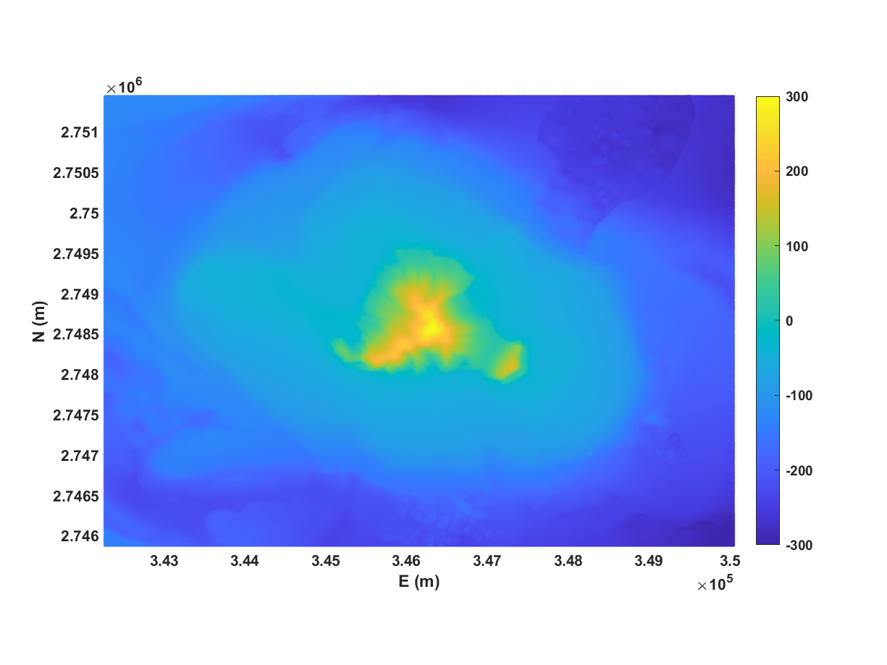
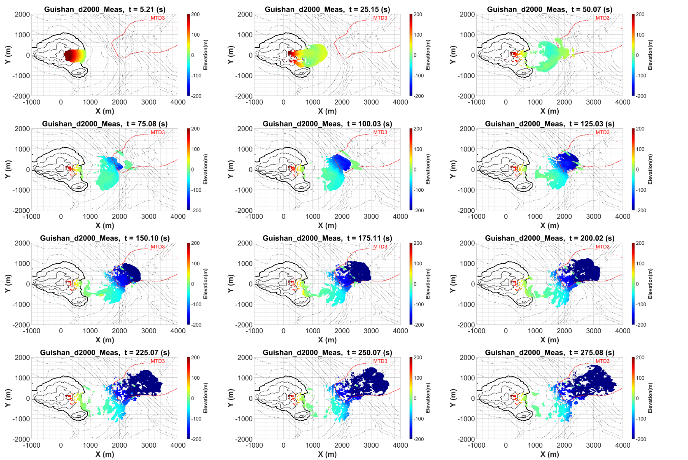

# Chapter 5 Guishan Island Landslide Dynamics and Near-Source Waves

## 5.1 Introduction

Guishan Island lies approximately 10 km offshore of the Yilan Plain in northeastern Taiwan. Deffontaines et al. (2022) document its structural and geomorphic setting. Huang (2018) interprets offshore deposits from bathymetric and acoustic data. These sources motivate investigating the link between failure geometry, material mobility and tsunami generation, but do not determine the acceleration or water-displacement history of a unique event.

The 2018 Anak Krakatau collapse demonstrates the value of combining pre- and post-failure geometry with coastal wave observations (Grilli et al., 2019). Offshore northern Sumatra, geophysical mapping and slope-stability analysis inform conditional source scenarios, with some subsurface properties assumed (Haridhi et al., 2023). The kinematic synthesis of Løvholt et al. (2015) shows that the relative roles of acceleration, velocity and deformation depend on the type of mass movement; deformation need not control every tsunami source.

Deformable landslides introduce uncertainty beyond source volume and position. A material can deform, spread, and settle during motion, changing its coupling with the surrounding water. Bingham-type formulations provide a continuum description of this behavior. Three-dimensional developments within the Splash3D framework have examined rheological flows and slump-generated waves against analytical or laboratory benchmarks (Wu et al., 2020; Vuong et al., 2020). These studies motivate the use of rheology in source calculations. Their benchmark performance does not, however, establish the properties of an unobserved natural event.

Laboratory wave-generation work provides controlled comparisons for three-dimensional sliding masses (Liu et al., 2005). Those rigid-slide cases are useful hydrodynamic benchmarks, whereas the present source experiments concern deformable material.

We examine which material configurations reproduce the broad MTD3 footprint and how density and interface treatment change landslide motion and the near-source surface response. The experiments distinguish deposit consistency from independent validation and identify the uncertainties that limit a unique event reconstruction.

## 5.2 Methods

### 5.2.1 Deposit geometry and source reconstruction

Huang (2018) associates MTD2 with an initial flank collapse and MTD3 with a possible subsequent slope slump. We focus on MTD3 and subtract its mapped thickness from present bathymetry to approximate the substrate before deposition. The conical restoration described below is an additional project assumption; it is not a pre-failure shape established by that geological interpretation.

The reconstructed source is defined from the difference between present terrain and an idealized cone centered on the island summit. The documented cone has a radius of 800 m and a height of 350 m. This is a geometric assumption necessitated by the absence of a complete pre-failure surface. Coordinates are translated to place the summit at the horizontal origin and rotated clockwise by 30° so that the modeled opening faces the positive source-domain direction. Figure 5.1 illustrates the bathymetric reconstruction.

The initial source experiments use x = −1000 to 4000 m, y = −2000 to 3000 m, and z = −300 to 400 m. The documented uniform mesh comprises 100 × 100 × 70 cells, corresponding to spacings of 50, 50, and 10 m. The initial water surface is z = 0 m. The bottom is no-slip, the upper boundary has zero prescribed pressure, and lateral boundaries are free-slip walls. These boundaries and the coarse initial mesh constrain interpretation of late-time source motion and outgoing waves.

Spatial discretization uncertainty has not been quantified through a systematic refinement sequence of the type described by Celik et al. (2008).

### 5.2.2 Three-dimensional flow and material representation

Splash3D solves the incompressible multiphase Navier–Stokes equations using a finite-volume formulation. Material volume fractions describe the distribution of air, water, and mobile material. In compact notation, the governing conservation statements are

$$
∇·u = 0,
$$

$$
∂(ρu)/∂t + ∇·(ρu⊗u) = −∇p + ∇·τ + ρg,
$$

$$
∂fₘ/∂t + ∇·(fₘu) = 0.
$$

Here u is velocity, p is pressure, ρ is mixture density, τ is the modeled stress tensor, g is gravitational acceleration, and fₘ is the volume fraction of material m. The fractional-volume interface description follows the VOF concept of Hirt and Nichols (1981). The later PLIC reconstruction is described in the Splash3D numerical lineage by Liu et al. (2005). The formulation uses a Smagorinsky-type closure, originating in Smagorinsky (1963) and given in the present three-dimensional notation by Wu et al. (2020).

The discontinuous bi-viscous model, abbreviated DBM, distinguishes a high-viscosity branch below a strain-rate threshold from a yielded branch. A scalar representation is

$$
μ(γ̇) = μ_A for γ̇ < γ̇_y.
$$

$$
μ(γ̇) = μ_B + τ₀/γ̇ for γ̇ ≥ γ̇_y.
$$

The strain-rate invariant must be defined consistently with the stress tensor when implementing this relation. The discontinuous model permits the unyielded viscosity μ_A to be specified independently of the yielded-branch parameters. It should therefore be distinguished from a conventional bi-viscous regularization with a prescribed branch connection. Wu et al. (2020) describe this independently prescribed low-rate branch as a modified bi-viscosity model. The term DBM is used in the supplied project records; the mathematical branch definition, rather than the label, identifies the model here.

For low-Reynolds-number laminar slope flows, Huang and García (1998) show that shear thinning can change runout and deposit form. This motivates testing constitutive alternatives when supported by sample data, but does not establish an erosion law or parameter set for Guishan material.

Guishan Island samples collected on 17 June 2023 were measured with a rotational viscometer. Their measured stress–rate relationship did not follow a simple Newtonian or Bingham idealization, and the project used a fitted viscosity–rate curve for the sample-based configuration. We refer to this configuration as the sample-based rheological case, identified as DBM in the project results. This terminology does not imply that a continuous empirical fit is mathematically identical to the piecewise constitutive law. The precise implemented curve and its low-rate regularization require confirmation from the simulation inputs because the report's printed equation and figure annotation differ.

### 5.2.3 Sensitivity experiments and diagnostic quantities

Constant dynamic viscosities of 10⁻³, 10⁵, and 10⁸ Pa s bracket mobile, intermediate, and nearly immobile behavior. They are numerical sensitivity cases rather than independently measured material states. Material densities of 2000 and 4000 kg/m³ are compared. The higher density is an extreme sensitivity bound and is not presented as an estimate of the bulk density of the deposit.

Motion is compared at three visually identified stages: first spreading to the outer mapped MTD3 boundary, settling to approximately half the depth of the basal slope, and occupying the mapped deposit area. These stages describe different parts of the deformation process. The recorded times are snapshot-based descriptors, not observations of the historical event or formally estimated confidence intervals. Spatial agreement is evaluated from the mapped footprint and the simulated distribution (Fig. 5.2).

The third-year experiments compare the original DBM-PLIC treatment with a DBM-Diffused treatment at 2000 kg/m³. Fifteen virtual gauges occupy the combinations x = 1000, 1500, and 2000 m and y = −500, −250, 0, 250, and 500 m. The comparison uses surface-elevation timing and excursions. Because the diffuse treatment changes material fractions near the interface, a difference in an extracted water surface may include a measurement-definition effect as well as a dynamical effect.

## 5.3 Results

### 5.3.1 Material mobility and deposit consistency

At 2000 kg/m³, the low-viscosity experiment spreads to the mapped boundary at approximately 35 s, reaches the intermediate settling stage at 90 s, and occupies the mapped area at 265 s. The sample-based rheological case reaches the same stages at approximately 35, 110, and 280 s (Table 5.1). Both reproduce the broad direction and eventual extent of the mapped deposit, despite their different constitutive descriptions.

The 10⁵ Pa s case evolves more slowly. Initial spreading occurs at approximately 75 s and intermediate settling at 440 s. Complete occupation of the mapped area is not recorded within 1000 s. At 10⁸ Pa s, no clear movement is recorded in the original source treatment over the diagnostic interval. This sequence supports a requirement for appreciable mobility within the tested reconstruction. It does not identify 10⁻³ Pa s as the physical viscosity of MTD3.

Raising density to 4000 kg/m³ changes the stages differently. For the sample-based case, initial spreading is delayed from 35 to 40 s, while intermediate settling advances from 110 to 70 s and footprint occupation advances from 280 to 150 s. The low-viscosity case exhibits the same pattern: the corresponding times change from 35, 90, and 265 s to 40, 65, and 165 s. Some material also extends beyond the mapped footprint. Density thus changes both timing and distribution. The results cannot be summarized adequately by saying that greater density accelerates every aspect of the motion.

Table 5.1. Snapshot-based stages of material motion.

| Configuration | Density kg/m³ | Boundary spreading s | Intermediate settling s | Footprint occupation s |
| --- | ---: | ---: | ---: | ---: |
| Constant 10⁻³ Pa s | 2000 | 35 | 90 | 265 |
| Constant 10⁻³ Pa s | 4000 | 40 | 65 | 165 |
| Constant 10⁵ Pa s | 2000 | 75 | 440 | >1000 |
| Constant 10⁵ Pa s | 4000 | 95 | 240 | 1000 |
| Constant 10⁸ Pa s | 2000 | No clear motion | No clear motion | No clear motion |
| Constant 10⁸ Pa s | 4000 | No clear motion | No clear motion | No clear motion |
| Sample-based case | 2000 | 35 | 110 | 280 |
| Sample-based case | 4000 | 40 | 70 | 150 |

### 5.3.2 Source-region surface response

The material enters the water near the reconstructed opening and spreads over the shallow portion of the slope before settling into deeper water. The source calculation shows an initial depression near the entry region and an outward positive disturbance. A later rebound at the source reaches approximately 30 m at about 175 s in the representative sequence. These values describe the local three-dimensional response under the stated source configuration.

Across the density and rheology experiments, some gauge maxima reach approximately 50 m, particularly in high-density mobile configurations. These maxima belong to a different comparison from the representative 30 m rebound. The 2024 conference presentation also reports maxima under its own set of configurations. Combining these values without their densities, gauge definitions, and simulation stages would obscure the source dependence of the result.

With DBM-Diffused enabled, positive and negative surface excursions are generally reduced while their main timing remains similar to the DBM-PLIC results. The reduction is more apparent in the intermediate-viscosity comparison. In the highly viscous diffusive case, a gauge near the opening records a late disturbance after approximately 500 s, associated with material reaching the water-entry region. The source report notes that local water fractions may fall below the 0.5 criterion used to identify the surface. Consequently, the reduced gauge response cannot yet be attributed entirely to physical mixing or enhanced energy dissipation.

## 5.4 Discussion

### 5.4.1 What the deposit constrains

The mapped MTD3 footprint helps reject nearly immobile configurations within the adopted source geometry. Its main contribution is to constrain the eventual reach and direction of mobile material. Similar footprint occupation in the sample-based and low-viscosity cases shows that this constraint is insufficient to identify a unique constitutive relation. Different densities also alter the chronology without necessarily eliminating broad spatial agreement.

This non-uniqueness matters for tsunami reconstruction. Two sources can arrive at similar final deposits after displacing water at different rates. The present comparison therefore supports a family of mobile reconstructions. Stronger discrimination would require deposit-thickness residuals, mass-balance checks, source-geometry ensembles, and observations independent of the footprint used for comparison. A uniformly successful reconstruction of MTD3 thickness is not established by visual footprint agreement.

### 5.4.2 Interface and surface-extraction uncertainty

The diffuse-interface comparison exposes a second uncertainty: the observable itself depends on how mixed cells are interpreted. If the gauge follows a selected volume-fraction isosurface, spreading the interface can move that isosurface without an equivalent change in a uniquely defined water boundary. Testing several thresholds, examining vertical water-fraction profiles, and checking material-volume conservation would help separate this effect from a change in the wave dynamics. A smaller extracted crest alone does not establish a more accurate source calculation.

### 5.4.3 Implications for source assessment

Material behavior influences landslide motion, while interface treatment affects both the solved dynamics and the extracted surface elevation. These effects should be assessed through material trajectories, deposit thickness, volume conservation and consistently defined near-source gauges. The present comparisons do not establish an event probability or recurrence interval.

For Guishan Island, the differences among settling histories and near-source surface excursions motivate improved bathymetry, material characterization and controlled numerical comparisons. The reported values remain conditional on the reconstructed geometry, material parameters and interface treatment. Independent observations would be needed to discriminate among source histories that produce similar final footprints.

## 5.5 Conclusions

Within the adopted reconstruction, mobile constant-viscosity and sample-based rheological cases reproduce the broad MTD3 footprint, whereas the most viscous original-interface cases do not. Their similar final extent does not determine a unique material rheology. Increasing density delays initial lateral spreading but accelerates subsequent settling and footprint occupation in the mobile cases.

The diffusive material treatment generally reduces recorded surface excursions while retaining their main timing. The dependence of surface extraction on material fraction prevents interpreting this reduction solely as physical damping. Together, the material and interface comparisons identify the measurements and numerical checks needed to assess the reconstructed landslide and its near-source wave generation.

## 5.6 Figures

Figure 5.1. Candidate substrate before MTD3 deposition. The mapped deposit thickness has been subtracted from the present bathymetry. The reconstruction supplies a modeling surface and does not independently determine the pre-failure flank geometry. Source: first-year research report, Figure 3-3.

Figure 5.2. Simulated material movement in the representative rheological configuration. The outlined area denotes the mapped MTD3 distribution. Colors indicate modeled material elevation. Source: third-year research report, Figure 4-1.
