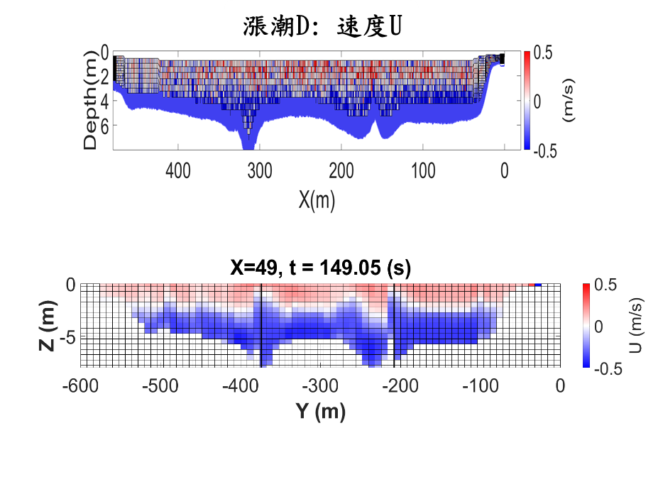
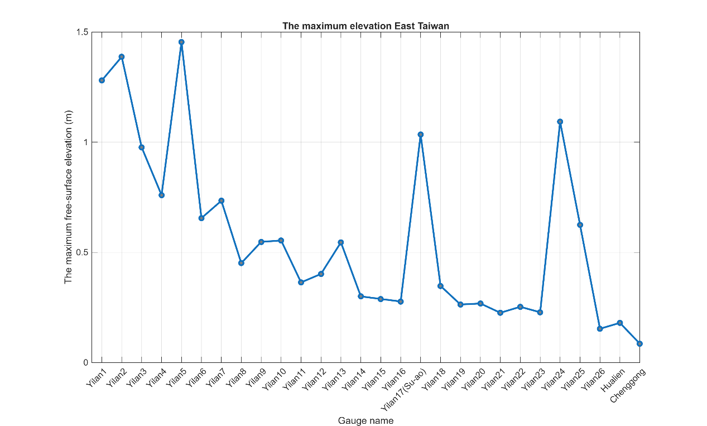

# A Reproducible Truchas Platform for Rheological Modeling of Coastal and Hydraulic Hazards

[Doctoral candidate's official English name]

Graduate Institute of Hydrological and Oceanic Sciences

National Central University

Advisor: Professor Tso-Ren Wu

[Degree date to be confirmed]

## Abstract

Scientific use of a specialized computational fluid dynamics platform depends on both its physical models and the ability to reconstruct the environment in which those models run. This dissertation develops and assesses a research workflow around the laboratory's Truchas/Splash3D platform, connecting rheological applications, containerized deployment, and agent-assisted simulation management. The physical applications concern local scour at Guandu Bridge and landslide-generated tsunami scenarios at Guishan Island. Their assessment distinguishes comparisons with field observations from comparisons between numerical configurations.

At Guandu Bridge, layered approach-flow boundaries reproduce principal features of measured tidal velocities more effectively than uniform boundary means. Recalculation of reported section–layer comparisons gives mean absolute differences of 0.0359 m/s for eight non-boundary ebb pairs and 0.0525 m/s for nine interior flood pairs. Local movable-bed experiments predict additional scour of 1.36–2.17 m, 1.95–2.71 m, and 4.41–5.75 m at approach velocities of 5, 6, and 8 m/s, respectively. Historical changes near P5 remain underpredicted by the idealized flat-bed configuration. At Guishan Island, a sample-based rheological configuration and a low-viscosity experiment reproduce the broad MTD3 deposit footprint with different settling histories. A diffuse material treatment changes extracted surface excursions, and regional tsunami calculations produce conditional Yilan maximum elevations approaching 1.5 m.

Deployment records document operation of the solver in WSL2/LXD environments. A 560000-cell benchmark reaches the selected output after 14 h 06 min on the legacy four-worker configuration and 4 h 27 min on a ten-worker 32-bit WSL configuration. The resulting factor of 3.17 measures a combined configuration difference rather than isolated container overhead. Reported surface comparisons show small aggregate differences together with a local 15 m discrepancy requiring diagnosis. Workflow demonstrations document parameter editing, sequential execution, post-processing, and bounded retries, including an unresolved MPI failure.

The integrated findings support preservation and continued assessment of the specialized platform. They also show that deposit agreement, numerical consistency, normal execution, and physical validity require different evidence. The dissertation establishes a traceable basis for that assessment and identifies the remaining requirements for constitutive reproducibility, controlled performance benchmarking, and reliable agent assistance.

Keywords: Truchas; Splash3D; rheology; local scour; landslide tsunami; reproducible computation; WSL2; LXD; scientific workflow

## Acknowledgements

[To be completed by the candidate. Committee membership, personal acknowledgements, and funding details are intentionally left for confirmation.]

## Contents

Chapter 1 Research motivation and scope

Chapter 2 Literature review

Chapter 3 Numerical framework and assessment methods

Chapter 4 Guandu Bridge flow and local scour

Chapter 5 Guishan Island landslide and tsunami scenarios

Chapter 6 Containerized deployment and numerical consistency

Chapter 7 Agent-assisted simulation workflows

Chapter 8 Conclusions and future work

References

Appendix A Reported velocity comparison data

## Principal symbols and abbreviations

| Symbol or abbreviation | Meaning |
| --- | --- |
| u and U | Velocity vector and streamwise component |
| p and ρ | Pressure and density |
| S and γ̇ | Strain-rate tensor and scalar shear-rate invariant |
| μ_A and μ_B | Unyielded and yielded viscosity parameters |
| τ₀ and γ̇_y | Stress intercept and transition shear rate |
| fₘ | Material volume fraction |
| η | Free-surface elevation relative to the defined datum |
| d_s | Additional scour depth below the initial bed |
| DBM | Discontinuous bi-viscous model |
| LES | Large-eddy simulation |
| PLIC and VOF | Piecewise linear interface calculation and volume of fluid |
| RFM | Rigid fluid method |
| MPI | Message Passing Interface |
| WSL2 | Windows Subsystem for Linux 2 |
| LXD | System-container and virtual-machine manager |
| MAE and RMSE | Mean absolute error and root-mean-square error |
| MTD | Mass transport deposit |

# Chapter 1 Research Motivation and Scope

## 1.1 Physical modeling and computational continuity

Three-dimensional free-surface models provide a way to examine processes that combine moving water, deformable material, and complex geometry. Local scour around a bridge foundation and waves generated by a landslide are different applications, but both require the numerical treatment of material interfaces and stress-dependent motion. The Truchas/Splash3D platform developed in the laboratory contains physical modules and accumulated application experience relevant to these problems. Maintaining access to those capabilities is a scientific concern as well as a software-maintenance task.

The platform's value includes more than its executable solver. Site-specific terrain preparation, boundary-condition interpretation, constitutive parameterization, and output extraction determine what a calculation means. If these steps cannot be reconstructed, retaining a source-code archive does not guarantee that a published result can be repeated. Conversely, an easily installed package has limited scientific value if its numerical outputs change in ways that compromise the intended application.

This dissertation examines physical modeling and computational continuity together. Its first component concerns the representation of mobile material in two field applications. Its second concerns preserving an executable environment for the customized solver. Its third concerns organizing repeated simulations and responding to execution failures through a combination of scripts and language-model assistance. The central proposition is that these components must be assessed through linked but distinct evidence.

The choice to retain Truchas reflects an investment in specialized capabilities and historical cases. It does not require a claim that other numerical frameworks lack comparable methods. A complete migration to another platform would entail implementation and validation work that is separate from preserving the present research asset. The relevant decision is whether preservation enables traceable, useful calculations at an acceptable maintenance cost, and how the limits of those calculations are established.

## 1.2 Research problems

The physical problem is to connect material descriptions and imposed flow conditions to observable outcomes. At Guandu Bridge, the model must represent tidal velocity structure before its local bed response can be interpreted. The historical bed-change maps add information about spatial erosion and deposition, but they integrate a longer period than the numerical experiments. At Guishan Island, the deposit footprint constrains final material extent while leaving source geometry and motion uncertain. Both applications therefore require care in deciding what constitutes calibration, qualitative consistency, or independent validation.

The constitutive problem concerns the relationship among an ideal Bingham material, a bi-viscous approximation, the discontinuous bi-viscous model, and a sample-based empirical curve. These descriptions are related but are not interchangeable. A curve can approximate measured apparent viscosity without establishing a unique yield mechanism or removing numerical sensitivity. The fitted relation, its units, its low-rate treatment, and the branch conventions must be explicit before a new constitutive contribution can be evaluated.

The deployment problem arises from a customized codebase whose libraries and execution procedures differ from current upstream software. Build notes identify dependencies including LAM/MPI, PGSLib, Chaco, and Ubiksolve. Binary architecture, compiler behavior, library compatibility, and input-processing routines can all affect a migration. Packaging these dependencies in a container addresses part of the operational problem. It does not establish that two platforms produce equivalent solutions or isolate the source of a timing difference.

The workflow problem concerns the gap between executing a command and completing a scientific experiment. Simulation management includes editing inputs, launching runs, reading logs, preserving restart state, converting outputs, and maintaining consistent time indexing. A language model can assist with these tasks through tools, but its ability to recover from a failure depends on the available operations and diagnostic information. A successful retry is not sufficient if the changes have altered the physical question.

## 1.3 Research questions and objectives

The dissertation addresses four questions. First, what do the available field comparisons and sensitivity experiments establish about rheological modeling at Guandu Bridge and Guishan Island? Second, what evidence supports continued use of the customized solver after deployment in WSL2/LXD? Third, which simulation-management operations have been demonstrated in the agent-assisted workflow, and which limitations remain? Fourth, how can these results be connected through a reproducible record of inputs, environments, transformations, and diagnostics?

The corresponding objectives are to formulate a consistent numerical description; quantify the available comparison data; preserve the distinction between observations and numerical references; and document the execution workflow sufficiently to support later controlled tests. The physical chapters provide application-specific results. The deployment and workflow chapters examine the conditions under which those results can be repeated and extended.

The work includes a reassessment of claims already present in the project material. For example, a high correlation with a legacy numerical field does not prove physical accuracy, a faster run on different hardware does not measure container overhead, and a broadly matching deposit does not determine a unique historical source. Making these distinctions strengthens the interpretation of the positive results by connecting each conclusion to an appropriate observable.

## 1.4 Scope and evidence

The physical scope comprises fixed-bed tidal flow comparisons, idealized movable-bed experiments around foundations P5–P8, and reconstructed landslide and tsunami scenarios at Guishan Island. The deployment scope comprises recorded legacy, WSL, and laboratory-machine configurations, including entries labeled 32-bit and 64-bit. The workflow scope comprises the documented scripted pipeline and agent demonstrations. Neither new field measurements nor new production-scale numerical experiments are introduced in this synthesis.

Different records have different evidential roles. Survey measurements constrain physical conditions. Reports and presentations describe experiments and selected results. Research notes preserve configuration decisions and troubleshooting history. Assistant-generated explanations within those notes are interpretive material rather than proof that a procedure succeeded. The assessment therefore prioritizes reported measurements, explicit configuration tables, visible result plots, and recorded failure cases over general claims of superiority or successful modernization.

The dissertation does not claim to resolve event probability at Guishan Island, structural safety at Guandu Bridge, complete cross-platform numerical equivalence, or general autonomous diagnosis. Those broader objectives would require additional evidence beyond the present records. The present contribution is the integrated physical and computational assessment needed to pursue them coherently.

## 1.5 Organization

Chapter 2 reviews the literature connecting scour, rheological source modeling, numerical reproducibility, and tool-assisted workflows. Chapter 3 develops the common numerical notation and comparison framework. Chapters 4 and 5 present the Guandu Bridge and Guishan Island applications. Chapter 6 analyzes deployment and numerical consistency, and Chapter 7 examines scripted and agent-assisted execution. Chapter 8 synthesizes the findings and defines the next tests needed to strengthen the physical and computational claims.

# Chapter 2 Literature Review

## 2.1 Three dimensional flow and local scour

### 2.1.1 Foundation geometry and flow structure

Local scour is a coupled response of the flow and the bed around an obstruction. Downflow, separation, and wake motion redistribute the forcing near a foundation, while the developing hole changes the subsequent flow. Roulund et al. (2005) combined numerical and experimental investigation around a circular pile, providing a reference for evaluating three-dimensional flow and scour together. The relevance to Guandu Bridge is methodological: both the hydrodynamics and the bed response require assessment. The circular-pile geometry itself is not a direct analogue for every component of the bridge foundations.

Baykal et al. (2015) examined flow and scour around a vertical circular cylinder with a model that represents sediment transport and bed morphology. This provides a useful contrast to the present rheological formulation. A transport model describes sediment fluxes and the resulting bed update, whereas a rheological continuum describes material deformation and movement through stresses. The formulations should be compared through observables and documented assumptions rather than ranked by the number of empirical coefficients alone.

For a complex foundation, several geometric scales may influence the flow simultaneously. Columns, connecting members, pile caps, and a protective mound can each redirect the approach flow. Their relative exposure changes as scour progresses. A representative-pier calculation must therefore state which components are resolved, which are embedded within a fixed solid description, and which lie below the initial bed. Similar minimum elevations do not establish that two models resolve the same erosion mechanism.

### 2.1.2 Tidal boundaries and field assessment

A tidal river introduces a further issue: a section can contain velocities of opposite signs at different depths. Replacing that distribution with one mean can preserve net transport while losing the vertical structure that controls foundation exposure. The Guandu measurements make this distinction explicit. The appropriate modeling question is how much of the observed structure the boundary must retain to reproduce interior measurements.

Field assessment also depends on the spatial and temporal support of the data. A section–layer mean summarizes many observations, a point profile resolves vertical structure at one location, and a surface drifter follows a path influenced by the near-surface flow. These measurements should not be pooled as interchangeable evidence. They constrain different aspects of the model. A surface streamline that resembles a drifter track can coexist with an inaccurate deep velocity field.

When boundary conditions are selected from the same campaign used for assessment, the resulting comparison is partly conditional on the observations. Excluding boundary sections is a useful diagnostic because it reduces direct prescription, but it does not create a new independent campaign. A stronger predictive test would use a different tide, discharge, or survey period with the parameterization fixed beforehand. This distinction is central to the interpretation of Chapter 4.

### 2.1.3 Cohesive beds and protection systems

The SRICOS research program investigated scour rates in cohesive soils at bridge piers (Briaud et al., 1999). Its relevance here is that the rate and duration of erosion matter alongside a maximum depth. A constitutive representation of a cohesive bed must likewise be assessed over time. A simulated hole that appears to stabilize during a short run need not represent an equilibrium under a complete flood hydrograph.

Protection adds another class of mechanics. Suaznabar et al. (2017) developed a computational approach to assess riprap-rock stability using fluid–structure interaction and laboratory assessment. This addresses a different observable from scour around a fixed protective shape. The latter can diagnose how the prescribed shape redirects flow, but cannot determine the onset of stone movement. For Guandu Bridge, separating these questions avoids interpreting a fixed-riprap experiment as a complete protection-performance test.

The remaining application gap is therefore specific. The model needs to connect realistic approach-flow structure and documented foundation geometry with a material description that transfers across locations and conditions. The large P5 discrepancy is valuable evidence for that gap. A convincing extension would evaluate bank geometry, bed heterogeneity, and protection permeability separately, with matched observations and numerical sensitivity checks.

## 2.2 Rheology and landslide generated waves

### 2.2.1 Yield stress and continuum idealization

Liu and Mei (1989) analyzed the slow spreading of a Bingham-fluid sheet on an inclined plane. Their formulation illustrates how finite yield stress changes the relation between forcing, motion, and final shape. It also identifies a controlled setting in which a constitutive idealization can be evaluated. Transferring such a description to a natural landslide requires additional assumptions about material composition, pore conditions, and deformation rate.

Wu et al. (2020) developed a three-dimensional Bingham-type landslide model and assessed rheological-flow cases. Vuong et al. (2020) extended the investigation to slump-generated tsunamis, including a laboratory comparison and sensitivity to material parameters. Together they establish the published methodological background of the laboratory framework. The Guishan study is an application of that framework with a reconstructed source and site-specific material information. It should not be presented as the initial invention of the underlying Bingham or volume-of-fluid methods.

A finite-viscosity approximation to an unyielded region is computationally convenient, but it permits deformation that an ideal rigid plug would not. The discontinuous bi-viscous model further allows the low-rate branch to be selected independently. An empirical curve fitted to apparent viscosity is another distinct object. Its agreement with a sample measurement does not demonstrate that it has the same yield structure as the piecewise model. This distinction must remain visible when a numerical configuration is labeled DBM but uses a fitted viscosity function.

### 2.2.2 Source motion and observable deposits

The tsunami source depends on how the moving material displaces water through time. Volume alone does not specify that process. Acceleration, deformation, submergence, and the surrounding bathymetry influence the generated disturbance. A final deposit constrains an outcome of those processes, while a wave record constrains part of their time history. They are complementary observations rather than substitutes.

Huang (2018) investigated northern-flank mass failure at Guishan Island using marine geophysical data. Deffontaines et al. (2022) supplied a broader structural and geomorphic interpretation of the volcanic island. These studies provide the geological setting and reconstruction constraints used in the application. They do not determine every parameter needed by the numerical source model. In particular, an idealized pre-failure cone is an assumption added to the observed terrain and deposit information.

If two rheologies produce similar footprints, the deposit comparison has not uniquely selected between them. Additional constraints could include thickness distribution, source scar volume, material sampling, or independent evidence of wave effects. The appropriate research question is which combinations of assumptions remain compatible with the available observations. Chapter 5 follows this conditional interpretation rather than treating one matching footprint as proof of the historical motion.

### 2.2.3 Interfaces and regional propagation

Hirt and Nichols (1981) introduced the fractional-volume basis of the volume-of-fluid method for tracking free boundaries. In the present multiphase application, material fractions also define the distribution of mobile sediment or landslide material. Geometrical interface reconstruction and a diffusive material treatment can produce different local fraction profiles. The surface diagnostic must therefore be specified along with the governing equations.

This issue is especially important when a selected isosurface represents the water level. In mixed cells, moving the threshold changes the extracted position. A reduction in an extracted crest can arise from a change in dynamics, a change in material distribution, or the extraction procedure. These alternatives can be distinguished by inspecting vertical fraction profiles and testing thresholds while retaining the same numerical solution.

Regional propagation adds a scale transition. A source-region Navier–Stokes calculation and a shallow-water propagation model do not evolve identical state variables. An elevation snapshot contains less information than the full three-dimensional velocity and material fields. Its use is a modeling approximation whose adequacy depends on the transfer time, remaining source motion, momentum treatment, and wave scales. This is why an elevation-only transfer should be described explicitly rather than assumed to be a fully conservative coupling.

## 2.3 Numerical assessment and reproducible computation

### 2.3.1 Physical validation and numerical consistency

Physical validation compares a calculation with observations of the modeled system. A numerical consistency comparison instead asks whether two implementations or configurations produce sufficiently similar outputs. A legacy simulation can be a useful reference for the second question even when it is not a measured truth. Confusing these comparisons can make a software migration appear to validate a physical model that has not been tested against nature.

The acceptance criterion should follow the quantity of interest. For a tsunami source, relevant outputs may include the generated surface field, material trajectory, and momentum. For scour, they may include minimum elevation, hole shape, and time evolution. An aggregate field correlation can remain high while a local error affects one of these outputs materially. A useful evaluation therefore includes local diagnostics and application-specific quantities alongside global statistics.

### 2.3.2 Preserving the computational experiment

Sandve et al. (2013) emphasize tracking the steps that produce a computational result, including software versions, parameters, and transformations. Wilson et al. (2014) discuss practices such as version control, modular organization, and automated checks that improve scientific software development. The common implication for this dissertation is that the reproducible object is the complete experiment, not only the final executable or figure.

The customized Truchas workflow contains several transformations capable of changing a reported result. Terrain is rotated and interpolated; material fractions are converted to surfaces; restart outputs are renumbered; and different binaries may be used under the same descriptive version label. Each transformation needs its own provenance. Without that record, a discrepancy can be attributed incorrectly to the physical solver when it originated during preprocessing or extraction.

Preservation should also include failed experiments. A log that records a missing dependency or an MPI error can delimit the conditions under which a workflow operates. Removing failed attempts from an archive would prevent reconstruction of the intervention that produced the final result. This is particularly relevant to agent-assisted retries, where several input revisions may precede normal termination.

### 2.3.3 Containerized environments

Kurtzer et al. (2017) describe scientific containers as a means of moving a computational environment between resources. The relevance to legacy modeling is dependency preservation: a container can retain a compatible userspace and software stack. Portability of that stack remains distinct from scalability and from numerical equivalence after migration.

Microsoft's WSL documentation distinguishes WSL1's translation-based architecture from WSL2's Linux kernel within a lightweight utility virtual machine (Microsoft, 2026). LXD documentation distinguishes system containers, which share the host kernel, from virtual machines with their own kernels (Canonical, 2026). In a WSL2/LXD arrangement, these mechanisms are layered. It is therefore inaccurate to describe the complete arrangement as containing no virtual machine.

These architectural descriptions do not predict the runtime of a particular CFD case. Hardware, worker count, compiler options, memory access, and output placement all matter. A useful benchmark changes one factor at a time where possible and records the complete configuration. When several factors differ, the measured speedup should be reported as a configuration comparison. Chapter 6 uses this interpretation for the available timing table.

## 2.4 Tool assisted and agent assisted workflows

### 2.4.1 Execution graphs and model assistance

Yao et al. (2023) investigated language models that interleave reasoning and actions through external tools. This provides conceptual background for a simulation assistant that reads a task, invokes parameter-editing functions, observes logs, and decides whether to continue. The published results do not establish performance for Truchas. That performance must be assessed on the actual simulation workflow and failure set.

Many operations in the laboratory pipeline are deterministic. Output conversion, restart preparation, and monotonic numbering can be implemented by scripts without a language model. The model-assisted component is most relevant where a natural-language request must be mapped to an experiment or where diagnostic evidence requires interpretation. Keeping these responsibilities distinct makes it possible to test whether the model adds value beyond a scripted baseline.

### 2.4.2 Execution success and scientific correctness

A retry policy needs an explicit definition of success. Normal process termination is an execution outcome. Scientific success also requires the requested physical configuration, an adequate simulation duration, complete outputs, and acceptable numerical diagnostics. An agent that changes viscosity, geometry, or forcing until a run succeeds may solve an execution problem while changing the experiment.

The workflow should therefore preserve immutable scientific intent and record each permitted numerical or operational change. Some interventions can be bounded in advance, such as correcting a known formatting error. Others require researcher review because they change the discretization or physical assumptions. The distinction is methodological rather than a claim that automated operation is inherently unreliable.

### 2.4.3 Evidence needed for evaluation

The available demonstrations show feasibility for selected edits and sequential tasks. A systematic evaluation would additionally define a task set, expected outcomes, known failure causes, and allowed interventions. It would report success rates, false repairs, time, resource use, and the fraction of cases requiring researcher intervention. Repeated trials would be needed if model outputs vary.

The documented MPI_Recv failure is particularly informative because it lies outside the provided tool coverage. It demonstrates a boundary of the current workflow. The proper response is to preserve the failure state and expand or revise the supported diagnostics through controlled development. It is not evidence that a larger language model would necessarily repair the numerical environment correctly.

## 2.5 Synthesis of research gaps

The physical literature motivates three-dimensional treatment of geometry, deformation, and material interfaces, while the applications show that boundary and constitutive information remain limiting. The reproducibility literature motivates preserving the full sequence from observation to figure, while the deployment records show why a packaged environment still needs numerical assessment. The agent literature motivates tool-mediated assistance, while the demonstrations show that execution and scientific correctness must be evaluated separately.

These gaps define a common research program: preserve and assess a specialized modeling capability without treating operational convenience as physical validation. The following chapters apply that principle to the numerical formulation, the two field applications, the container migration, and the simulation-management workflow.

# Chapter 3 Numerical Framework and Assessment Methods

## 3.1 Model lineage and scope

The numerical platform originates from the Truchas code developed at Los Alamos National Laboratory. The current upstream project describes a multiphysics platform oriented toward manufacturing processes (LANL, 2026). The laboratory's Splash3D development adapted an earlier Truchas framework for free-surface hydrodynamics, turbulence, and coastal applications. Subsequent laboratory versions include specialized rheological and moving-body modules. The names Truchas, Splash3D, and DBM therefore describe related parts of a development history rather than three independent solvers.

Version labels alone are insufficient to identify a calculation. The application reports refer to earlier Splash3D developments, whereas the deployment work concerns customized Truchas 2.5.3 configurations. The physical results should be linked to the actual executable and inputs used at the time. A successful later migration does not imply that every historical application was rerun with that migrated binary. This distinction is retained throughout the dissertation.

The common formulation described below establishes consistent notation for interpreting the recorded experiments. Details that depend on a particular source version, such as the exact pressure solver or material-mixture rule, require confirmation against that version. A generic description of current upstream software is not substituted for an audit of the laboratory code.

## 3.2 Conservation equations and interfaces

### 3.2.1 Incompressible multiphase flow

The modeled materials are treated as incompressible phases. Their distribution is represented by material volume fractions fₘ, with 0 ≤ fₘ ≤ 1 and Σfₘ = 1 in the fluid portion of a cell. The velocity satisfies

$$
∇·u = 0.
$$

For a volume-weighted density ρ, the momentum equation is expressed in conservative notation as

$$
∂(ρu)/∂t + ∇·(ρu⊗u) = −∇p + ∇·τ + ρg.
$$

The material fractions satisfy an advection equation,

$$
∂fₘ/∂t + ∇·(fₘu) = 0.
$$

This representation permits air, water, and mobile material to share a computational domain. It does not imply that all physical processes within a sediment mixture are resolved. Grain motion, pore-water migration, fragmentation, and entrainment may require additional constitutive or transport descriptions. Their omission must be evaluated for the target observable.

The stress is written as τ = 2μ_eff S, where S is the symmetric velocity-gradient tensor. The material viscosity can depend on deformation rate. Turbulence closure adds modeled stress at unresolved scales. Surface-tension and other optional terms should be included in a case description only when enabled in the relevant calculation; their presence in a generic solver does not establish their use in the field applications.

### 3.2.2 Finite volumes and geometric reconstruction

Finite-volume discretization integrates conservation over each computational cell. The balance is determined by fluxes through its faces and local source terms. This is useful for multiphase applications because material exchange can be expressed in the same geometric framework as momentum transport. Conservation is nevertheless a property to verify from the implemented fluxes and run diagnostics, not an automatic guarantee from the method's name.

The volume-of-fluid approach represents an interface through partial cell occupancy (Hirt and Nichols, 1981). In a geometrical PLIC reconstruction, an interface cell contains a plane whose orientation is inferred from the fraction field and whose position is chosen to recover the specified volume. The original source treatment seeks to retain a relatively sharp interface during advection. The DBM-Diffused variant intentionally permits a different material distribution. Both treatments require a consistent diagnostic for reporting the water or sediment surface.

Terrain and fixed foundations are embedded in the computational geometry. Their effective representation depends on cell size and the treatment of intersected cells. A coarse mesh can preserve the approximate volume of a structure while inadequately resolving a narrow gap or local curvature. Consequently, a refinement test should assess the geometric features relevant to the process as well as global flow statistics.

## 3.3 Turbulence and temporal solution

### 3.3.1 Large eddy simulation

The project formulation uses a Smagorinsky-type closure for unresolved turbulent stresses (Smagorinsky, 1963). The eddy viscosity has the conventional form

$$
μ_t = ρ(C_s Δ)²|S|,   |S| = √(2S:S),
$$

where Δ is a grid-related filter scale and C_s is a model coefficient. The Guishan report gives C_s = 0.15 in its formulation. That value should be linked to the actual case input before it is assigned to all runs. Near-wall treatment, interface cells, and high-viscosity material can modify how the closure behaves in practice.

An LES label does not establish that all important turbulent structures are resolved. The very different horizontal spacings in the reach-scale Guandu model illustrate why resolution must be considered explicitly. The available field comparisons assess aggregated velocity structure; they do not verify a turbulence spectrum or wall-resolved stresses at each foundation. This limits the level of mechanism that can be inferred from the streamline plots.

### 3.3.2 Pressure projection and viscous stiffness

The laboratory methodology describes a predictor–projection sequence. Momentum is advanced to an intermediate state and a pressure correction is used to obtain a velocity field satisfying the discrete incompressibility condition. In schematic notation,

$$
∇·[(1/ρ)∇pⁿ⁺¹] = (∇·u*)/Δt,
$$

followed by a pressure-gradient correction of u*. The precise operators, boundary terms, and tolerance must correspond to the selected code version. This equation describes the role of the pressure solve; it is not a source-code-level specification of the complete algorithm.

Large constitutive viscosities make an explicit diffusion step restrictive because its stable time increment decreases with increasing viscosity and decreasing squared cell size. The project adopts implicit viscous treatment to address this stiffness. Implicit treatment changes the stability constraint but does not remove the need to resolve transient processes or converge the nonlinear constitutive update. Large viscosity contrasts and abrupt branch changes can still affect convergence.

## 3.4 Material descriptions

### 3.4.1 Bingham and bi-viscous models

An ideal Bingham material has a finite yield stress and a yielded relation between stress and shear rate. A numerical bi-viscous approximation replaces the ideal unyielded behavior with a finite, large viscosity. The discontinuous bi-viscous formulation allows the low-rate viscosity to be specified independently of the yielded branch. With γ̇ = √(2S:S), a scalar constitutive description is

$$
μ_r(γ̇) = μ_A for γ̇ < γ̇_y,
$$

$$
μ_r(γ̇) = μ_B + τ₀/γ̇ for γ̇ ≥ γ̇_y.
$$

The transition convention, parameter units, and treatment at the threshold are part of the constitutive specification. A very large μ_A approximates resistance but does not set deformation identically to zero. The parameter τ₀ is the intercept of the yielded branch in this notation. It should not be conflated automatically with every definition of a measured yield stress.

For Guandu material the reported values are γ̇_y = 0.53 s⁻¹, μ_B = 120.08 Pa s, and τ₀ = 63.64 Pa. The report leaves μ_A unspecified numerically. A reproducible implementation requires that missing value and the rule for mixing rheological properties in interface cells. The parameter set is therefore a documented starting point rather than a complete executable material specification.

### 3.4.2 Empirical viscosity curves

The Guishan sample measurements motivated a fitted apparent-viscosity relation because the stress–rate data did not follow one simple idealization. This is a useful extension of the material-description workflow: an empirical relation can retain measured behavior over a specified range. Its scientific interpretation depends on the sampling procedure, rate interval, fitting objective, and uncertainty.

The numerical coefficients printed in the report text and the equation drawn on its fitted-curve figure are not algebraically identical. Accordingly, this dissertation does not select one expression as the implemented law. The original input or routine must resolve that discrepancy. A smooth curve should also not be called a complete regularization solely because it lacks a piecewise jump. A term proportional to 1/γ̇ is singular at zero rate unless a cutoff or alternative limit is defined.

A controlled evaluation of the proposed curve would retain the same geometry, grid, forcing, and extraction method while changing only the constitutive relation. It would compare measured stresses or viscosities, material motion, numerical residuals, and conservation. Until that comparison is available, the supported result is use of a sample-based configuration and its documented behavior. Elimination of numerical oscillations or universal improvement over DBM has not been established.

### 3.4.3 Moving bodies and mixed failure

The qualification presentation describes the rigid fluid method and related moving-body applications, while identifying combined RFM–DBM simulation of mixed slide–slump failures as planned work. The dissertation retains that distinction. Successful separate modules do not establish that a mixed-material implementation conserves momentum or behaves correctly when both are active.

The Guishan application considered here uses deformable material representations rather than a demonstrated fully coupled mixture of independently moving blocks and rheological sediment. Mixed failures remain an important extension, but require explicit coupling equations and matched benchmarks. The same distinction applies to future stone-motion modeling around bridge protection.

## 3.5 Execution structure and configuration provenance

The draft architecture identifies an input-reading stage, setup, and a cycle driver. Its schematic sequence is input interpretation, geometry and material initialization, an initial pressure-related prepass, and repeated material-advection and flow-solution operations. Laboratory extensions enter both during initialization and within the transient loop. Examples include bathymetry loading, gauge setup, time-dependent boundary treatment, and output processing.

This sequence explains where configuration changes can enter the experiment. An input parser may change a parameter before the solver starts; a boundary module may change forcing at every cycle; and a post-processing routine may change the reported surface after the calculation. Tracking only source-code modifications would miss the other two sources of variation.

Each case should therefore retain a configuration manifest containing the source revision, executable identity, compiler and libraries, mesh, material properties, boundary conditions, time controls, worker count, output cadence, and extraction definitions. The manifest should link derived figures to their original fields. For a restart sequence, it should also record checkpoint identity and physical time, so that output numbering cannot be mistaken for elapsed time.

## 3.6 Assessment hierarchy

The assessment proceeds from controlled constitutive or hydrodynamic cases to field comparisons and then to deployment and workflow comparisons. The published rheological benchmarks provide methodological background. The Guandu observations test application-specific flow structure. Its historical bed changes and the Guishan deposit constrain morphology, with the temporal limitations discussed in the application chapters. Cross-platform fields then test consistency relative to a numerical reference. Agent demonstrations test operational behavior.

For scalar comparisons, define e_i = q_i − q_ref,i. The reported summary measures are

$$
MAE = Σ|e_i|/N,   RMSE = √(Σe_i²/N).
$$

$$
Bias = Σe_i/N.
$$

The reference, sample support, weighting, and physical time must accompany these statistics. A coefficient of determination measures a different aspect of agreement and should not be substituted for an error magnitude. Maximum absolute difference and its location help identify local failures concealed by averages.

Grid assessment should examine the quantity of interest on multiple resolutions with consistent geometry and forcing. Conservation checks should include material volume and any transfers between model stages. Workflow checks should verify that the requested experiment was executed, including failed attempts and any repaired inputs. These shared requirements provide the basis for interpreting the results in Chapters 4–7.

# Chapter 4 Guandu Bridge Flow and Local Scour

The Guandu application links measured tidal flow to local bed-response scenarios around foundations P5–P8. This chapter retains the distinction between a bathymetry-based fixed-bed model and separate idealized movable-bed domains. It quantifies the available velocity comparisons and examines where the local setup reproduces or misses surveyed morphology.

## 4.1 Study site and observations

### 4.1.1 Bathymetry and coordinate systems

The modeling dataset combines riverbed point-cloud measurements acquired in November 2022, velocity observations supplied by the National Taiwan Ocean University team, bed samples collected in October 2022, and foundation geometry. Additional bathymetric comparisons cover 2013–2022 and 2022–2025. These periods are kept separate because their differences represent distinct histories of erosion, deposition, and possible maintenance.

The collaborative project defines a common horizontal frame with the origin at P8 and axes aligned parallel and perpendicular to the foundation direction. Data are translated and rotated into that frame and subsequently into the computational frame. Velocity vectors are transformed with the same rotations as position coordinates. In the fixed-bed model the inlet and outlet follow the chosen computational orientation. In the local model, x is the nominal approach-flow direction and the foundation is rotated relative to that direction to impose the attack angle. These transformations avoid interpreting a change of coordinates as a change in flow physics.

The reach model retains measured bathymetry. The local movable-bed experiments instead start from a flat bed at z = −5 m and a water surface at z = 0 m. The flat bed provides a consistent datum for scenario comparisons, but it omits bank shape, existing scour holes, and spatial sediment variability. Consequently, local results represent additional scour within an idealized configuration rather than a direct continuation of the surveyed bed.

### 4.1.2 Velocity measurements

Section measurements were collected on 1 March 2023 at five transects denoted A, B, C2, D, and E. Their nominal positions span approximately 100 m upstream to 100 m downstream of the foundations, with intermediate sections at 50 m and near the bridge. The measured east and north velocity components are rotated to obtain the streamwise component U used in the comparison. Instrument limitations leave gaps near the bed. Point measurements on 27 March 2023 supplement this region, with reported near-bed speeds of approximately 0.14–0.30 m/s during ebb and 0.24–0.35 m/s during flood.

Ebb observations show faster shallow flow, slower deep flow, and reduced velocities behind the foundations. Flood observations are more complex: some sections contain downstream-directed shallow flow and upstream-directed deeper flow. The transition between these directions includes a relatively slow intermediate layer. Surface-drifter records comprise five ebb tracks and two flood tracks. They provide a qualitative check on horizontal pathways rather than a measurement of the near-bed forcing responsible for scour.

### 4.1.3 Sediment measurements

A rotational viscometer was used to measure the relationship among apparent viscosity, shear rate, and derived shear stress for the collected bed material. The project identifies a threshold rate γ̇_y = 0.53 s⁻¹, a yielded-branch viscosity μ_B = 120.08 Pa s, and a stress intercept τ₀ = 63.64 Pa. The high-viscosity branch μ_A is described as large, but its numerical value is not specified in the report text. The measured sample provides a basis for the constitutive parameterization, while uncertainty remains concerning preparation, water content, repeatability, and spatial representativeness.

The simulations therefore treat the fitted parameter set as a material model to be assessed at the site. They do not assume that one sample captures all bed layers or that the yield threshold alone determines erosion. The 2025 scenario comparison includes a threshold-rate sensitivity experiment, described below, to examine part of this uncertainty.

## 4.2 Numerical methods

### 4.2.1 Hydrodynamics and rheology

The model uses the laboratory-developed Splash3D framework, derived from Truchas, to solve three-dimensional incompressible flow. Finite-volume discretization is combined with volume-of-fluid tracking of the material interfaces (Hirt and Nichols, 1981). The project formulation includes large-eddy simulation with a Smagorinsky closure (Smagorinsky, 1963). The governing equations can be written as

$$
∇·u = 0,
$$

$$
∂(ρu)/∂t + ∇·(ρu⊗u) = −∇p + ∇·[2(μ_r + μ_t)S] + ρg,
$$

$$
∂fₘ/∂t + ∇·(fₘu) = 0.
$$

The symbols denote velocity u, pressure p, mixture density ρ, gravitational acceleration g, strain-rate tensor S = (∇u + ∇uᵀ)/2, rheological viscosity μ_r, turbulent viscosity μ_t, and material fraction fₘ. The scalar rate is defined here as γ̇ = √(2S:S). The convention must match the parameter implementation when comparing measured and numerical rates.

Mobile sediment is represented by the discontinuous bi-viscous model, abbreviated DBM. Below the threshold rate the material has viscosity μ_A. Above it, the yielded branch has viscosity μ_B + τ₀/γ̇. The high-viscosity branch approximates strongly resistant material using a finite numerical viscosity. It permits small deformation and should not be described as an exact rigid solid. Implicit viscous treatment avoids the particularly restrictive explicit diffusion time step associated with large viscosity. The related rheological formulation and benchmark problems are documented by Wu et al. (2020).

This continuum approach does not resolve individual grains, aggregate break-up, or stone displacement. Its advantage is a direct material-stress representation within the multiphase flow solver. Its suitability for the present bed is assessed through field flow comparisons and the resulting spatial bed-change patterns. A reduction in the number of empirical transport coefficients does not eliminate constitutive or numerical uncertainty.

### 4.2.2 Fixed-bed configurations

The documented ebb domain extends from x = −100 to 150 m, y = −700 to 100 m, and z = −15 to 5 m. The selected grid has 100 × 100 × 40 cells and spacings of 2.5, 8.0, and 0.5 m. The bottom is no-slip, the lateral walls are free-slip, the top is open with zero prescribed pressure, and the outflow uses a hydrostatic-pressure condition. Vertical refinements of 1.0, 0.5, 0.25, and 0.2 m were examined in the presentation record. The report describes little additional improvement below 0.5 m, but a complete grid-convergence uncertainty estimate is not available.

For ebb, a uniform boundary using the section-A mean fails to reproduce the observed vertical contrast and weakens the foundation-shadow regions. The adopted boundary separates the upper and lower flow at 3 m below the surface. The documented velocity vectors are (0.7423, −0.2409, −0.0211) m/s in the shallow layer and (0.2844, −0.0984, −0.0030) m/s in the deeper layer. These values represent selected spatial averages at the boundary, not a resolved inflow turbulence field.

For flood, successive uniform and two-layer tests do not reproduce the full counterflow structure. The adopted configuration uses three layers at section E together with a section-A boundary contribution. The E-layer vectors reported in the examination presentation are (0.1789, −0.0542, −0.0298), (0.0024, −0.0201, −0.0178), and (−0.3690, 0.0219, −0.0263) m/s. The section-A vector is (−0.1724, 0.0325, −0.0043) m/s. Exact boundary assignment and the flood-domain x extent must be checked against the final inputs because the report's extent, cell count, and stated spacing are internally inconsistent.

### 4.2.3 Local movable-bed experiments

Separate local domains are constructed for P5–P8. The documented x limits are −150 to 150 m and the vertical limits are −15 to 5 m; the transverse span is approximately 200 m around each foundation. The bed starts at −5 m. A prescribed-velocity inlet, hydrostatic-pressure outlet, open upper boundary, no-slip bottom, and free-slip sides define the local experiment. Twenty-metre control regions near the inflow and outflow and a velocity ramp over the first 50 s are used to stabilize startup. Final mesh counts, numerical tolerances, and run durations remain essential configuration information to recover from the original input files.

The initial P7 experiments compare U = 0.34 and 5.0 m/s over a range of attack angles. Further angle tests identify +15° and −25° as useful representatives of different surveyed erosion and deposition patterns. These are selected scenario angles rather than independently measured directions of two historical floods. The selected angles are then applied to P5–P8 at U = 5, 6, and 8 m/s.

The project associates 5 and 6 m/s with earlier 20-year and 200-year design-flow assessments. Those associations are inherited from the cited engineering assessment, not estimated anew from the present simulations. The 8 m/s case is an additional extreme forcing scenario motivated by prior bridge-failure modeling. No recurrence probability is assigned to it at Guandu Bridge.

Existing P7 riprap is represented as fixed solid geometry and compared with a configuration without that geometry. The resulting differences diagnose flow redistribution around the prescribed protection footprint. They do not evaluate stone mobility, permeability, filter loss, or the probability of armour failure.

### 4.2.4 Comparison measures

The report provides measured and simulated layer-mean U values for ten ebb and fifteen flood section–layer combinations. We transcribe those pairs and calculate mean absolute error, root-mean-square error, and mean signed difference, with the difference defined as simulated minus measured velocity. Each reported section–layer pair receives equal weight. These statistics consequently summarize aggregated values and do not represent area-weighted or pointwise field error.

We report the complete sets and comparisons excluding sections used for boundary specification. For ebb, section A is excluded from the latter calculation. For flood, sections A and E are excluded. The remaining sections still belong to the same campaign used to develop the setup, so this separation improves interpretability but does not constitute an independent validation campaign.

Scour is reported using the positive additional depth d_s = z_b,0 − z_b,min, where z_b,0 = −5 m. Bed elevation z_b,min is retained separately when needed. Historical survey differences are compared spatially with model bed change. They are not treated as event-matched measurements of maximum transient scour.

## 4.3 Results

### 4.3.1 Fixed-bed flow assessment

The layered ebb boundary reproduces the principal shallow–deep velocity contrast and reduced streamwise velocity behind the foundations (Fig. 4.1). Across all ten layer means, MAE is 0.0291 m/s and RMSE is 0.0381 m/s. Excluding section A gives MAE = 0.0359 m/s and RMSE = 0.0426 m/s for eight comparisons (Table 4.1). The positive mean difference indicates an overall tendency to overpredict U in this aggregated comparison. The largest difference is 0.0677 m/s in the deeper C2 layer.

Flood results reproduce part of the measured counterflow structure but show larger discrepancies (Fig. 4.2). Across all fifteen pairs, MAE is 0.0787 m/s and RMSE is 0.1022 m/s. The largest difference is 0.2652 m/s in the deep section-A layer. Excluding A and E reduces the comparison to nine pairs, with MAE = 0.0525 m/s and RMSE = 0.0632 m/s. All nine signed differences are non-negative, indicating a systematic positive-U bias in these interior layer means. The model is therefore more successful at reproducing the broad ebb pattern than at matching the full flood-tide structure.

The surface-drifter comparisons show broadly similar pathways to the modeled streamlines. Ebb pathways are relatively stable, whereas flood pathways continue to change during the calculation. This difference is consistent with the more complex flood velocity field. A streamline comparison cannot quantify trajectory error in an unsteady flow without a matched time-dependent particle calculation.

Table 4.1. Recalculated differences between reported layer-mean streamwise velocities. Units are m/s except n.

| Tidal phase and comparison set | n | MAE | RMSE | Mean difference | Maximum absolute difference |
| --- | ---: | ---: | ---: | ---: | ---: |
| Ebb all sections | 10 | 0.0291 | 0.0381 | 0.0203 | 0.0677 |
| Ebb excluding A | 8 | 0.0359 | 0.0426 | 0.0258 | 0.0677 |
| Flood all sections | 15 | 0.0787 | 0.1022 | 0.0583 | 0.2652 |
| Flood excluding A and E | 9 | 0.0525 | 0.0632 | 0.0525 | 0.1060 |

### 4.3.2 Attack angle and historical bed change

For P7, the two selected angles reproduce different parts of the 2013–2022 spatial pattern. The +15° case better represents one combination of erosion and deposition, while the −25° case reproduces another erosion band. Their complementary behavior supports sensitivity to approach direction. It does not prove that exactly two events or these precise angles generated the historical morphology.

At P6 and P7, modeled additional scour of order 1–2 m at U = 5 m/s resembles parts of the surveyed bed change. At P8, the +15° case captures an erosion band and deposition toward the channel-facing side, while some upstream deposition observed in the survey is absent from the corresponding model pattern. Recovery after a flood could contribute to this difference, but the available comparison does not identify its cause uniquely.

P5 presents a clearer quantitative limitation. The historical survey indicates local changes of approximately 4–5 m, whereas the corresponding idealized simulations produce approximately 1–2 m of additional scour at U = 5 m/s. Its bank-adjacent position and possible sediment differences provide plausible explanations, but they were not isolated by controlled experiments. The discrepancy should therefore be retained as evidence that the flat-bed, shared-material approximation has limited transferability across the site.

### 4.3.3 Velocity sensitivity at P5 to P8

The detailed summary table gives additional scour depths of 1.36–2.17 m at U = 5 m/s and 1.95–2.71 m at U = 6 m/s (Table 4.2). The 8 m/s cases reach 4.41–5.75 m. These exact ranges are wider than the rounded ranges used in the report narrative. In particular, the extreme-scenario lower bound is 4.41 m rather than 4.5 m when all tabulated cases are included.

P7 and P8 generally develop deeper scour than P5 and P6 in the selected idealized cases. At +15° and U = 8 m/s, the additional depths are 5.47 and 5.51 m for P7 and P8, compared with 4.62 and 4.53 m for P5 and P6. At −25°, the largest depth is 5.75 m at P8, corresponding to a minimum bed elevation of −10.75 m. P5 reaches 5.05 m, while P6 reaches 4.41 m. The response to angle thus depends on the foundation configuration.

For all eight angle–foundation combinations, the increment in additional scour between 6 and 8 m/s exceeds the increment between 5 and 6 m/s. Because the velocity intervals differ and the experiment uses a particular ramp and finite duration, this observation does not identify a universal scaling exponent. It does show that modest extrapolation from the two lower-velocity scenarios would understate the changes produced by the extreme forcing in this model.

Table 4.2. Maximum additional scour below the initial bed at z = −5 m. Values follow the detailed summary table; the P5 −25° value at 6 m/s differs from one narrative passage and requires final input/output confirmation.

| Foundation | Angle degrees | U 5 m/s depth m | U 6 m/s depth m | U 8 m/s depth m |
| --- | ---: | ---: | ---: | ---: |
| P5 | +15 | 1.36 | 1.95 | 4.62 |
| P6 | +15 | 1.40 | 1.98 | 4.53 |
| P7 | +15 | 1.98 | 2.64 | 5.47 |
| P8 | +15 | 1.92 | 2.61 | 5.51 |
| P5 | −25 | 1.61 | 1.98 | 5.05 |
| P6 | −25 | 1.66 | 1.97 | 4.41 |
| P7 | −25 | 1.94 | 2.43 | 5.42 |
| P8 | −25 | 2.17 | 2.71 | 5.75 |

### 4.3.4 Transient development under extreme forcing

The extreme scenarios initially show little bed change. Upstream scour becomes apparent near 40 s while the imposed velocity approaches its target over the first 50 s. By approximately 100 s, bed elevations around the foundations commonly reach −6 to −7 m. A transverse band of erosion subsequently travels downstream and passes the foundation region during approximately 200–300 s in several cases. Strongly curved near-foundation streamlines coincide spatially with the deeper holes.

Many reported maxima occur near 260 s, but this timing is not universal. P7 at −25° reaches its largest additional depth, 5.42 m, near 160 s; its later value near 260 s is smaller. P8 at −25° reaches its reported maximum near 270 s. These differences show why a common final snapshot is insufficient to identify the maximum over the complete run.

The traveling erosion band may reflect a transient generated by the imposed ramp and boundary configuration. The present evidence does not establish that it represents a measured flood front. A ramp-duration sensitivity test, a longer upstream domain, and time histories of flow and bed stress are needed before assigning a field mechanism to this feature.

### 4.3.5 Protection geometry and updated survey comparison

Adding the fixed P7 riprap geometry reduces some flow through the middle of the foundation but does not consistently protect the upstream column regions. At U = 6 m/s, the reported difference maps show local increases in scour of approximately 0.5–0.8 m near those regions (Fig. 4.3). The result indicates that blocking one pathway can redirect flow toward another vulnerable area. It does not imply that riprap generally aggravates scour or that a different protection layout would have the same effect.

The 2022–2025 survey comparison is examined separately at P7. A 12-case sensitivity set combines γ̇_y = 0.1, 0.53, 2.5, and 12.5 s⁻¹ with U = 1.0, 2.5, and 5.0 m/s at +15°. A subsequent case at U = 1.5 m/s with γ̇_y = 0.53 s⁻¹ most closely matches the reported spatial trend. This represents calibration to the more recent bed-change pattern. Retaining the same threshold as the earlier sample parameterization is consistent with that scenario, but it does not demonstrate unchanged bed properties throughout the site.

## 4.4 Discussion

### 4.4.1 Boundary realism and the meaning of validation

The fixed-bed comparison demonstrates the value of preserving measured vertical structure in the prescribed approach flow. A uniform mean removes the upper–lower contrast during ebb and cannot reproduce the layered reversal during flood. The improvement from layering is therefore physically interpretable: the boundary retains features present in the measurements that are lost during averaging.

The quantitative assessment is more qualified than a general claim of excellent agreement. Boundary-section agreement is partly imposed. Interior flood comparisons retain a positive-U bias, and the section-A deep-layer difference is substantial relative to the observed velocity. Moreover, averaging can conceal local errors of opposite signs. The reported MAE and RMSE should be supplemented by collocated profiles, measurement uncertainties, and field-based spatial error measures before they are used to establish predictive accuracy under a new tide or discharge.

The movable-bed assessment addresses a different question. Historical survey differences contain multiple events, recovery, background channel change, and possible intervention. A short idealized run can reproduce a spatial feature without reproducing its formation history. The complementary +15° and −25° patterns therefore identify useful scenario directions rather than reconstructing two verified historical forcing events.

### 4.4.2 Limits of a rheological bed description

The DBM formulation provides a means to connect resistance and mobilization to measured material properties. It also introduces quantities that require numerical and physical assessment, including the finite unyielded viscosity, threshold convention, and material-interface treatment. The continuum model's bed elevation depends on how the sediment surface is extracted from mixed cells. Consistent extraction is necessary when comparing scour depths across meshes or platforms.

The P5 discrepancy shows that a shared material model and flat initial bed do not capture every site condition. Bank-induced flow concentration, sediment layering, and existing bed relief are plausible missing controls. Their effects should be tested independently rather than absorbed into a single adjusted rheological parameter. This is particularly relevant if the model is used to rank protection alternatives, since calibration to one morphology may not transfer to another geometry.

### 4.4.3 Implications for protection and monitoring

The fixed-riprap experiments indicate a local redistribution of exposure. They support examining the interaction between protection geometry and the surrounding foundation rather than assessing protection solely by its footprint. They do not resolve porous flow or armour movement. Assessment of rock stability requires an additional mechanical problem, as illustrated by the fluid–structure methodology of Suaznabar et al. (2017). Comparisons with a permeable protection model and stone-stability measurements would be needed to evaluate protection performance more fully.

The largest simulated additional scour, 5.75 m, provides a scenario magnitude for further assessment. Rounding it to 6 m does not create a validated warning threshold. An operational threshold also requires a surveyed datum, measurement error, pile and cap geometry, remaining embedment, structural capacity, and a decision procedure. The appropriate use of these calculations is to inform that assessment while preserving the distinction between a numerical scenario maximum and a criterion for bridge operation.

## 4.5 Conclusions

Layered approach-flow boundaries improve the representation of measured tidal flow at Guandu Bridge. Recalculated differences in section–layer means are smaller during ebb than flood, and flood results retain a positive streamwise bias. These findings support the two-stage modeling sequence while limiting claims of uniform hydrodynamic accuracy.

For the selected local configurations, maximum additional scour increases from 1.36–2.17 m at 5 m/s to 1.95–2.71 m at 6 m/s and 4.41–5.75 m at 8 m/s. Approach angle changes the spatial response, and the two selected angles reproduce different parts of surveyed morphology. The larger historical changes at P5 remain underpredicted by the idealized setup.

The prescribed P7 riprap geometry reduces some central flow pathways while locally increasing upstream scour. Protection performance is therefore sensitive to the interaction among layout, foundation geometry, and approach direction. The results provide conditional evidence for targeted model improvement and monitoring design. They do not independently determine flood recurrence, reconstruct the complete survey history, or establish a structural warning threshold.

## 4.6 Figures

Figure 4.1. Measured and simulated streamwise velocity at section D during ebb. The source report fills some unmeasured regions for graphical comparison; those filled regions must not be treated as additional observations. Source: final project report, Figure 29.

Figure 4.2. Measured and simulated streamwise velocity at section D during flood. Layered reversal is represented, while the aggregate comparison retains a positive-U bias. Source: final project report, Figure 40.

Figure 4.3. Difference in modeled P7 bed response with and without fixed riprap geometry at +15° and −25°. The source comparison uses U = 6 m/s. Negative differences indicate lower bed elevation with the prescribed riprap geometry, corresponding to increased scour. The displayed panels are at 190 and 195 s, respectively. Source: final project report, Figure 63.

# Chapter 5 Guishan Island Landslide and Tsunami Scenarios

## 5.1 Introduction

Guishan Island lies approximately 10 km offshore of the Yilan Plain in northeastern Taiwan. Its volcanic terrain and adjacent submarine slopes provide a setting in which flank instability can generate waves close to an inhabited coast. Geological and geophysical studies document the island's structural complexity and offshore mass movements (Huang, 2018; Deffontaines et al., 2022). The relevant hazard question is how the geometry and mobility of a plausible failure translate into a tsunami source. A mapped deposit is valuable evidence, but it records the outcome of mass transport rather than the complete acceleration and water-displacement history.

Deformable landslides introduce uncertainty beyond source volume and position. A material can deform, spread, and settle during motion, changing its coupling with the surrounding water. Bingham-type formulations provide a continuum description of this behavior. Three-dimensional developments within the Splash3D framework have examined rheological flows and slump-generated waves against analytical or laboratory benchmarks (Wu et al., 2020; Vuong et al., 2020). These studies motivate the use of rheology in source calculations. Their benchmark performance does not, however, establish the properties of an unobserved natural event.

The problem also spans different numerical scales. A three-dimensional source model can represent vertical motion and material deformation, whereas a regional shallow-water model can propagate a prescribed disturbance over a larger area. Transferring a surface snapshot between these models requires a consistent geographical transformation and an explicit treatment of the remaining source motion and momentum. Similarly, an imposed positive and negative displacement pattern is a scenario definition, not a measured failure trajectory. These distinctions affect how regional maxima should be interpreted.

This study addresses three connected questions. Which material configurations reproduce the broad MTD3 footprint? How do density and material-interface treatment change the simulated source behavior? How do a transferred surface field and idealized directional sources affect regional elevation patterns? We examine these questions through a sequence of source experiments and regional scenarios, retaining the distinction between deposit consistency and independent validation. The resulting interpretation emphasizes the mechanisms supported by the calculations and the uncertainties that limit reconstruction of a unique event.

## 5.2 Methods

### 5.2.1 Deposit geometry and source reconstruction

The geological framework follows the northern-flank investigation of Huang (2018), which used bathymetric and acoustic observations to distinguish mass transport deposits. The simulations focus on MTD3. Deposit thickness is subtracted from the contemporary bathymetry to approximate the substrate before deposition. This operation restores a candidate basal surface. It does not recover erosion during motion, the original distribution of all failed material, or changes unrelated to the modeled event.

The reconstructed source is defined from the difference between present terrain and an idealized cone centered on the island summit. The documented cone has a radius of 800 m and a height of 350 m. This is a geometric assumption necessitated by the absence of a complete pre-failure surface. The source volume used in the subsequent wave analysis is approximately 1.32 × 10⁷ m³. Coordinates are translated to place the summit at the horizontal origin and rotated clockwise by 30° so that the modeled opening faces the positive source-domain direction. Figure 5.1 illustrates the bathymetric reconstruction.

The initial source experiments use x = −1000 to 4000 m, y = −2000 to 3000 m, and z = −300 to 400 m. The documented uniform mesh comprises 100 × 100 × 70 cells, corresponding to spacings of 50, 50, and 10 m. The initial water surface is z = 0 m. The bottom is no-slip, the upper boundary has zero prescribed pressure, and lateral boundaries are free-slip walls. These boundaries and the coarse initial mesh constrain interpretation of late-time source motion and outgoing waves. The regional calculation is a separate stage and is not assigned this source-domain mesh.

### 5.2.2 Three-dimensional flow and material representation

Splash3D solves the incompressible multiphase Navier–Stokes equations using a finite-volume formulation. Material volume fractions describe the distribution of air, water, and mobile material. In compact notation, the governing conservation statements are

$$
∇·u = 0,
$$

$$
∂(ρu)/∂t + ∇·(ρu⊗u) = −∇p + ∇·τ + ρg,
$$

$$
∂fₘ/∂t + ∇·(fₘu) = 0.
$$

Here u is velocity, p is pressure, ρ is mixture density, τ is the modeled stress tensor, g is gravitational acceleration, and fₘ is the volume fraction of material m. Volume-of-fluid tracking follows the framework introduced by Hirt and Nichols (1981), with geometric interface reconstruction in the original source treatment. The project formulation uses large-eddy simulation with a Smagorinsky closure (Smagorinsky, 1963).

The discontinuous bi-viscous model, abbreviated DBM, distinguishes a high-viscosity branch below a strain-rate threshold from a yielded branch. A scalar representation is

$$
μ(γ̇) = μ_A for γ̇ < γ̇_y.
$$

$$
μ(γ̇) = μ_B + τ₀/γ̇ for γ̇ ≥ γ̇_y.
$$

The strain-rate invariant must be defined consistently with the stress tensor when implementing this relation. The discontinuous model permits the unyielded viscosity μ_A to be specified independently of the yielded-branch parameters. It should therefore be distinguished from a conventional bi-viscous regularization with a prescribed branch connection. The formulation and its numerical treatment are discussed by Wu et al. (2020).

Guishan Island samples collected on 17 June 2023 were measured with a rotational viscometer. Their measured stress–rate relationship did not follow a simple Newtonian or Bingham idealization, and the project used a fitted viscosity–rate curve for the sample-based configuration. We refer to this configuration as the sample-based rheological case, identified as DBM in the project results. This terminology does not imply that a continuous empirical fit is mathematically identical to the piecewise constitutive law. The precise implemented curve and its low-rate regularization require confirmation from the simulation inputs because the report's printed equation and figure annotation differ.

### 5.2.3 Sensitivity experiments and diagnostic quantities

Constant dynamic viscosities of 10⁻³, 10⁵, and 10⁸ Pa s bracket mobile, intermediate, and nearly immobile behavior. They are numerical sensitivity cases rather than independently measured material states. Material densities of 2000 and 4000 kg/m³ are compared. The higher density is an extreme sensitivity bound and is not presented as an estimate of the bulk density of the deposit.

Motion is compared at three visually identified stages: first spreading to the outer mapped MTD3 boundary, settling to approximately half the depth of the basal slope, and occupying the mapped deposit area. These stages describe different parts of the deformation process. The recorded times are snapshot-based descriptors, not observations of the historical event or formally estimated confidence intervals. Spatial agreement is evaluated from the mapped footprint and the simulated distribution (Fig. 5.2).

The third-year experiments compare the original DBM-PLIC treatment with a DBM-Diffused treatment at 2000 kg/m³. Fifteen virtual gauges occupy the combinations x = 1000, 1500, and 2000 m and y = −500, −250, 0, 250, and 500 m. The comparison uses surface-elevation timing and excursions. Because the diffuse treatment changes material fractions near the interface, a difference in an extracted water surface may include a measurement-definition effect as well as a dynamical effect.

### 5.2.4 Regional and directional scenarios

The regional calculations use COMCOT, a tsunami propagation and inundation model. In the transferred-field experiment, a Splash3D surface-elevation snapshot at t = 10 s is converted from Cartesian to geographical coordinates, geometrically aligned with the receiving bathymetry, and interpolated onto the regional grid. The documented procedure transfers elevation. A transfer of depth-integrated momentum has not been established in the available methodological record. The experiment is therefore interpreted as propagation from an imposed surface state rather than a fully demonstrated conservative coupling of two solvers.

A second experiment family places an idealized source at eight positions around the island: north, northeast, east, southeast, south, southwest, west, and northwest. The reported source dimensions are approximately 500 × 266 × 100 m, with the negative displacement directed landward and the positive displacement seaward. The geometrical product is 1.33 × 10⁷ m³, close to the nominal source volume but not exactly equal to it. This geometrical volume should not be equated automatically with the integral of a signed water-surface disturbance. These experiments assess sensitivity to source placement and orientation under prescribed geometry.

The regional figure ordinate identifies the output as maximum free-surface elevation. We retain that quantity when reporting regional maxima. It differs from crest-to-trough wave height, run-up above a coastal datum, and inland flow depth. No conversion among these quantities is assumed.

## 5.3 Results

### 5.3.1 Material mobility and deposit consistency

At 2000 kg/m³, the low-viscosity experiment spreads to the mapped boundary at approximately 35 s, reaches the intermediate settling stage at 90 s, and occupies the mapped area at 265 s. The sample-based rheological case reaches the same stages at approximately 35, 110, and 280 s (Table 5.1). Both reproduce the broad direction and eventual extent of the mapped deposit, despite their different constitutive descriptions.

The 10⁵ Pa s case evolves more slowly. Initial spreading occurs at approximately 75 s and intermediate settling at 440 s. Complete occupation of the mapped area is not recorded within 1000 s. At 10⁸ Pa s, no clear movement is recorded in the original source treatment over the diagnostic interval. This sequence supports a requirement for appreciable mobility within the tested reconstruction. It does not identify 10⁻³ Pa s as the physical viscosity of MTD3.

Raising density to 4000 kg/m³ changes the stages differently. For the sample-based case, initial spreading is delayed from 35 to 40 s, while intermediate settling advances from 110 to 70 s and footprint occupation advances from 280 to 150 s. The low-viscosity case exhibits the same pattern: the corresponding times change from 35, 90, and 265 s to 40, 65, and 165 s. Some material also extends beyond the mapped footprint. Density thus changes both timing and distribution. The results cannot be summarized adequately by saying that greater density accelerates every aspect of the motion.

Table 5.1. Snapshot-based stages of material motion.

| Configuration | Density kg/m³ | Boundary spreading s | Intermediate settling s | Footprint occupation s |
| --- | ---: | ---: | ---: | ---: |
| Constant 10⁻³ Pa s | 2000 | 35 | 90 | 265 |
| Constant 10⁻³ Pa s | 4000 | 40 | 65 | 165 |
| Constant 10⁵ Pa s | 2000 | 75 | 440 | >1000 |
| Constant 10⁵ Pa s | 4000 | 95 | 240 | 1000 |
| Constant 10⁸ Pa s | 2000 | No clear motion | No clear motion | No clear motion |
| Constant 10⁸ Pa s | 4000 | No clear motion | No clear motion | No clear motion |
| Sample-based case | 2000 | 35 | 110 | 280 |
| Sample-based case | 4000 | 40 | 70 | 150 |

### 5.3.2 Source-region surface response

The material enters the water near the reconstructed opening and spreads over the shallow portion of the slope before settling into deeper water. The source calculation shows an initial depression near the entry region and an outward positive disturbance. A later rebound at the source reaches approximately 30 m at about 175 s in the representative sequence. These values describe a local three-dimensional response and should not be substituted for a regional coastal maximum.

Across the density and rheology experiments, some gauge maxima reach approximately 50 m, particularly in high-density mobile configurations. These maxima belong to a different comparison from the representative 30 m rebound. The 2024 conference presentation also reports maxima under its own set of configurations. Combining these values without their densities, gauge definitions, and simulation stages would obscure the source dependence of the result.

With DBM-Diffused enabled, positive and negative surface excursions are generally reduced while their main timing remains similar to the DBM-PLIC results. The reduction is more apparent in the intermediate-viscosity comparison. In the highly viscous diffusive case, a gauge near the opening records a late disturbance after approximately 500 s, associated with material reaching the water-entry region. The source report notes that local water fractions may fall below the 0.5 criterion used to identify the surface. Consequently, the reduced gauge response cannot yet be attributed entirely to physical mixing or enhanced energy dissipation.

### 5.3.3 Regional elevations and source direction

The COMCOT experiment initialized from the three-dimensional snapshot produces a reported maximum of approximately 30 m in waters adjacent to the source and around 15 m in part of the island's northeastern coastal area. Selected island gauges reach approximately 9 m. These outputs have different spatial supports: a maximum over a mapped domain need not coincide with a maximum sampled at a limited set of gauges.

At the mainland reference stations, the plotted maximum surface elevations reach approximately 1.5 m along the Yilan coast, with smaller values at Hualien and Chenggong (Fig. 5.3). The regional plot supports a spatially variable coastal response rather than uniform attenuation with distance. Local bathymetry, source position, and wave propagation paths all contribute to this variation.

The eight idealized directional scenarios likewise produce strong spatial differences. Their largest island-adjacent values remain close to their imposed sources and are reported to exceed 40 m. Selected mainland stations reach elevations of order 1 m, with some regional maxima near 1.5 m. Because source location and orientation vary together, these experiments establish sensitivity to their combined configuration. They do not isolate an azimuth-only effect or demonstrate that direction dominates every other uncertain source parameter.

## 5.4 Discussion

### 5.4.1 What the deposit constrains

The mapped MTD3 footprint helps reject nearly immobile configurations within the adopted source geometry. Its main contribution is to constrain the eventual reach and direction of mobile material. Similar footprint occupation in the sample-based and low-viscosity cases shows that this constraint is insufficient to identify a unique constitutive relation. Different densities also alter the chronology without necessarily eliminating broad spatial agreement.

This non-uniqueness matters for tsunami reconstruction. Two sources can arrive at similar final deposits after displacing water at different rates. The present comparison therefore supports a family of mobile reconstructions. Stronger discrimination would require deposit-thickness residuals, mass-balance checks, source-geometry ensembles, and observations independent of the footprint used for comparison. A uniformly successful reconstruction of MTD3 thickness is not established by visual footprint agreement.

### 5.4.2 Interface and model-transfer uncertainty

The diffuse-interface comparison exposes a second uncertainty: the observable itself depends on how mixed cells are interpreted. If the gauge follows a selected volume-fraction isosurface, spreading the interface can move that isosurface without an equivalent change in a uniquely defined water boundary. Testing several thresholds, examining vertical water-fraction profiles, and checking material-volume conservation would help separate this effect from a change in the wave dynamics. A smaller extracted crest alone does not establish a more accurate source calculation.

The regional transfer introduces additional assumptions. At t = 10 s the landslide-generated disturbance is still evolving. An elevation-only initialization may omit momentum and later forcing. Geometrical scaling and rotation also need to preserve the intended length and amplitude units. Until those operations and the receiving grid are fully documented, the regional maxima should be treated as conditional scenario results. They identify potentially affected sectors but do not establish a calibrated inundation forecast.

### 5.4.3 Implications for scenario assessment

The useful outcome is a structured separation of uncertainties. Material behavior influences the source motion, interface treatment influences both dynamics and extracted surface elevations, and source placement influences regional patterns. These factors should be varied and evaluated with observables appropriate to each stage. No event probability, recurrence interval, or warning lead time can be assigned from the present scenario set alone.

For Guishan Island, the modeled contrast between strong local disturbances and lower but spatially variable mainland elevations motivates continued source investigation. The numerical values are conditional on the reconstructed geometry and imposed fields. Their practical use is to guide where improved bathymetry, deposit characterization, and source-transfer validation would most reduce uncertainty.

## 5.5 Conclusions

Within the adopted reconstruction, mobile constant-viscosity and sample-based rheological cases reproduce the broad MTD3 footprint, whereas the most viscous original-interface cases do not. Their similar final extent does not determine a unique material rheology. Increasing density delays initial lateral spreading but accelerates subsequent settling and footprint occupation in the mobile cases.

The diffusive material treatment generally reduces recorded surface excursions while retaining their main timing. The dependence of surface extraction on material fraction prevents interpreting this reduction solely as physical damping. Regional calculations produce selected Yilan maximum elevations approaching 1.5 m, and idealized source scenarios demonstrate sensitivity to combined location and orientation. These findings support conditional hazard scenarios and identify the measurements and numerical checks needed for a defensible historical reconstruction.

## 5.6 Figures

Figure 5.1. Candidate substrate before MTD3 deposition. The mapped deposit thickness has been subtracted from the present bathymetry. The reconstruction supplies a modeling surface and does not independently determine the pre-failure flank geometry. Source: first-year research report, Figure 3-3.

Figure 5.2. Simulated material movement in the representative rheological configuration. The outlined area denotes the mapped MTD3 distribution. Colors indicate modeled material elevation. Source: third-year research report, Figure 4-1.

Figure 5.3. Regional maximum free-surface elevations for the transferred-snapshot experiment. Gauge labels are retained from the source plot. This is a scenario output, not a record of observed coastal elevations. Source: third-year research report, Figure 4-15.

# Chapter 6 Containerized Deployment and Numerical Consistency

## 6.1 Deployment problem and design rationale

The laboratory workflow historically combines a customized Linux solver with Windows-based preparation and visualization. This arrangement preserves access to specialized physical modules but introduces dependencies on particular compilers, libraries, file formats, and operational knowledge. Development notes describe cross-system line-ending problems, incompatible library architectures, input-parser changes, and repeated output-conversion steps. These are concrete sources of execution friction, although their frequency and cost have not been measured systematically.

The migration strategy packages a compatible Linux userspace in LXD and operates it within WSL2. WSL2 supplies a Linux kernel in a utility virtual machine, while an LXD system container shares that kernel and isolates its userspace (Microsoft, 2026; Canonical, 2026). This arrangement allows Linux execution alongside a Windows research environment. Its practical attraction is preservation of the customized stack and access to local tools, rather than a presumption of universal speed or complete isolation from host behavior.

The alternative of adopting current upstream Truchas would require a separate reconciliation of input conventions, code changes, and laboratory extensions. The upstream project remains relevant for comparison, but a common project name does not make two code histories interchangeable. The present work therefore examines preservation and assessment of the laboratory version. It does not establish that this is the only viable modernization route.

## 6.2 Dependency and architecture issues

Build notes identify Chaco, PGSLib, Ubiksolve, an MPI implementation, and legacy compiler or parser dependencies. The migration must maintain agreement among their binary interfaces. Mixing 32-bit and 64-bit libraries can prevent linking or lead to incompatible assumptions about integer and address sizes. The label 64-bit must therefore be defined carefully: executable architecture, integer width, addressability, and floating-point precision are different properties.

The notes describe changes to source syntax, compiler handling of nested calls or overloaded operators, and input-processing routines. These records are useful for identifying a reproducible build recipe. They do not establish, by themselves, which changes are necessary or sufficient for every platform. A final recipe should contain the exact compiler versions, options, library builds, source revision, and a small verification suite. Advice retained in a troubleshooting conversation must be distinguished from changes confirmed by a successful build and test.

Container export and import can preserve an environment image. To make that image scientifically useful, its identity must be recorded together with the case manifest and executable checksum. A container that can start is an operational artifact; a container that can reproduce a specified result with documented tolerances is a stronger research artifact. These are separate milestones.

## 6.3 Recorded timing experiment

The benchmark note uses a Guishan configuration with 100 × 80 × 70 cells, or 560000 cells in total. It records material density 2000 kg/m³, constant viscosity 10⁻³ Pa s, and an output interval of 5 s. This grid differs from the 100 × 100 × 70 initial source grid described in Chapter 5. The timing record is therefore treated as a distinct benchmark configuration and is not assigned retrospectively to every physical result.

Elapsed times are recorded to output bin 25 (Table 6.1). The table includes legacy Machine 160, WSL configurations, and Machine 174. The records do not provide enough hardware and software metadata to isolate all causes of the differences. In particular, machines, worker counts, architecture labels, and possibly build settings change across entries.

Table 6.1. Recorded benchmark timings to output bin 25.

| Platform | Recorded architecture label | Workers | Elapsed time | Minutes |
| --- | --- | ---: | --- | ---: |
| Machine 160 | 32-bit | 4 | 14 h 06 min | 846 |
| Machine 160 | 32-bit | 10 | 5 h 37 min | 337 |
| WSL | 32-bit | 4 | 5 h 48 min | 348 |
| WSL | 32-bit | 10 | 4 h 27 min | 267 |
| WSL | 64-bit | 10 | 3 h 35 min | 215 |
| Machine 174 | 64-bit | 10 | 4 h 00 min | 240 |

Using the legacy four-worker entry as reference, the ten-worker 32-bit WSL entry has a recorded speed ratio of 846/267 = 3.17. The ten-worker 64-bit WSL entry gives 846/215 = 3.93. These ratios summarize the total configuration difference. They do not measure container overhead or prove that binary architecture alone caused the further reduction.

Within Machine 160, increasing the recorded worker count from four to ten gives a ratio of 846/337 = 2.51. Within 32-bit WSL, the same worker-count change gives 348/267 = 1.30. The worker-count ratio is 2.5. The legacy result is close to that nominal scaling ratio, while the WSL result shows much smaller additional benefit. Without repeated timings and confirmed identical work, neither value should be used to estimate a general scaling law. They indicate that the useful worker count depends on the configuration.

The four-worker cross-platform ratio is 846/348 = 2.43, while the ten-worker ratio is 337/267 = 1.26. Their difference further cautions against a single statement about virtualization speed. A controlled comparison would use the same hardware, equivalent builds and inputs, fixed output placement, explicit worker binding, and repeated runs. It would separately report initialization, solver, and output costs if those phases can be measured reliably.

## 6.4 Reported field comparison

The draft comparison uses the legacy four-worker field as a numerical reference. It describes 8000 horizontal samples at a selected time of approximately 125.02 s. For the ten-worker WSL comparison, the note reports MAE = 0.0204 m, RMSE = 0.3420 m, mean difference = 0.0041 m, and R² = 0.9953. It also reports 99.00% of sampled differences below 0.10 m and a maximum absolute difference of 15.0 m at approximately (1025, −875) m.

These values indicate close agreement over much of the sampled field together with a small number of potentially important outliers. RMSE is about 16.8 times MAE, consistent with a highly uneven difference distribution. This observation follows from the reported summaries; the complete distribution still needs to be recovered from matched fields. A high correlation does not eliminate the significance of the local maximum.

The notes propose wetting–drying or interface reconstruction as an explanation for the maximum. That explanation remains a hypothesis without collocated fraction profiles, timing checks, and a comparison of extraction rules. The maximum could also be affected by coordinate registration, a different wet mask, different physical times, or parallel-decomposition sensitivity. The available summaries do not distinguish among those causes. Accordingly, the dissertation does not conclude that the outlier is harmless or that numerical dissipation is negligible.

A later note labeled DBM-64bit reports R² = 0.9918 for a comparison associated with a different output index. It is not pooled with the earlier R² = 0.9953 result. Their case identities, output times, constitutive settings, and masks must be reconciled before a joint conclusion is made. The 64-bit label also does not establish that the same floating-point precision changed between the compared runs.

## 6.5 A reproducible migration assessment

The next assessment should start with a case that can be executed in every environment with exactly identified inputs. One comparison should retain worker count while changing environment; another should retain environment while changing worker count. A third can assess the architecture transition with consistent libraries and an explicit precision specification. Repeated timings would quantify variability and reveal initialization or file-system effects.

Numerical outputs should be compared at matched physical times. Comparing the same output filename or index is insufficient if adaptive stepping or output scheduling differs. The extraction method should use the same volume-fraction threshold, wet mask, interpolation, and vertical convention. Where a surface contains multiple intersections, the rule selecting an intersection must be specified.

Field differences should be evaluated globally and near the quantities of interest. For the Guishan benchmark, these include source-region extrema, spatial wave patterns, and material distribution. For rheological verification, an analytical or well-characterized material-flow case can test behavior without the geometric complexity of the island. Material-volume and momentum diagnostics would help distinguish an extraction discrepancy from a change in the solved dynamics.

Acceptance tolerances should be set according to intended use before examining all differences. A tolerance adequate for visualizing an offshore wave field may be inadequate for a threshold decision at one gauge. Numerical reproducibility is therefore best stated as agreement within a defined tolerance for a defined case and observable. Exact bitwise equality is a separate, stronger requirement and is not assumed here.

## 6.6 Findings and limitations

The deployment records demonstrate that the customized platform can execute in the recorded WSL/LXD workflow and that selected configurations reach the benchmark output faster than the legacy reference. The timing table provides a useful baseline for further controlled tests. The reported field summaries also support substantial similarity over much of one sampled surface field.

The evidence does not isolate container overhead, establish a universal speed advantage, or complete cross-platform verification. The local 15 m discrepancy and the identity of later 64-bit comparisons remain unresolved. The defensible conclusion is that the migrated environment is a viable platform for continued numerical assessment, with its physical and reproducibility claims tied to case-specific tests. This conclusion preserves the practical value of modernization without assigning it evidence that has not yet been collected.

# Chapter 7 Agent Assisted Simulation Workflows

## 7.1 Simulation management as part of the experiment

The numerical solver is only one component of the research workflow. A typical experiment also requires preparation of an input file, selection of an executable and worker count, launch and monitoring, output conversion, restart management, and extraction of figures or statistics. Repeated sensitivity studies multiply these operations. Their ordering and bookkeeping affect whether the final dataset represents the intended experiment.

The earlier laboratory procedure required manual conversion of binary outputs and manual renaming across restart segments. The automation notes describe a revised pipeline that integrates these operations. A further prototype accepts a natural-language task and invokes tools for input editing, execution, diagnosis, and post-processing. This chapter distinguishes the deterministic pipeline from the language-model-assisted layer so that the contribution of each can be assessed.

The objective is controlled assistance with an identified simulation task. It is not to transfer responsibility for constitutive choices or scientific interpretation to a model. Tool-mediated assistance is useful when it reduces operational friction while retaining the experiment definition and a record of interventions. The relevant evaluation must therefore include both execution behavior and preservation of scientific intent.

## 7.2 Deterministic execution and restart pipeline

### 7.2.1 Operations documented in the revised workflow

The automation record identifies a launch script, output-conversion routines, restart generation, and output-folder numbering. The revised sequence selects an input, launches the solver, converts available binary results, and prepares restart material when execution ends. Subsequent invocation can continue from the retained state. The reported GMV workflow also continues numbering across segments, reducing the need for manual file-name adjustment before visualization.

These changes address a concrete ambiguity in the earlier process. An output number can restart from zero even though physical time continues. Combining files solely by their local names can therefore overwrite or misorder results. An automated pipeline can enforce a monotonically ordered sequence, but it should preserve the physical time and original segment identity as well. Renaming cannot replace time provenance.

The July 2026 note also records incomplete numbering support for formats other than GMV. That limitation matters because a successful conversion in one format does not demonstrate equivalent behavior for Tecplot or EnSight. The dissertation therefore treats conversion support as format-specific until tests establish otherwise.

### 7.2.2 Checkpoints and termination

A restart file generated after abnormal termination is a candidate recovery artifact. It is not necessarily a scientifically valid state. Its usefulness depends on whether the solver completed a consistent checkpoint, whether the associated input and executable are retained, and whether restarting preserves the relevant fields. A robust workflow should test continuation against an uninterrupted reference calculation.

The same principle applies to post-processing triggered by normal termination. A process can exit without having reached the requested physical time or without writing every required field. Completion should therefore check the final time, expected outputs, log status, and selected conservation diagnostics. These checks connect automation to the numerical assessment described in Chapter 3.

## 7.3 Agent assisted architecture

### 7.3.1 Task state and tool boundaries

The architecture note describes a stateful graph with stages for intent parsing, input generation, simulation execution, diagnosis, and post-processing. Shared state contains the task specification, mesh settings, simulation status, retry count, and results. Conditional routing determines whether to continue, retry, skip a stage, or terminate. This design resembles the broader concept of interleaving model decisions with external actions discussed by Yao et al. (2023).

The prototype's actions are constrained by its tools. The demonstration notes name operations such as mesh and numerical-setting updates. The language model can propose a change only within the fields and procedures those tools support. A failure outside that coverage cannot be assumed repairable simply because its log is readable.

The architecture explanation is retained as a description of the prototype. It should be reconciled with the archived implementation before the dissertation makes claims about exact graph semantics or error handling. A conversation explaining a program is useful design documentation, but it is not equivalent to executing and inspecting every branch of that program.

### 7.3.2 Preserving the experiment definition

The requested physical configuration should remain identifiable throughout a task. Geometry, forcing, material parameters, and target duration define the experiment. Mesh and numerical tolerances may also affect the scientific result even when they are considered computational settings. An automatic repair that changes them must be recorded as an intervention rather than treated as an invisible correction.

A useful task record contains the original request, parsed parameters, original input, every changed input, invoked tool, diagnostic evidence, and output identity. The workflow should preserve the reason for each change and whether it modifies the experiment or repairs an operational defect. This record makes a successful run reviewable and enables a failed repair to be reproduced.

## 7.4 Demonstration evidence

The agent record documents mesh changes, changes involving a mesh ratio, and an automatic simulation-and-repair sequence. It also describes deriving a set of tasks from a prompt and attempting them sequentially. The documented retry ceiling is five. Once a run is judged to have ended normally, the workflow proceeds to post-processing.

The record includes a failure in Task 11 associated with MPI_Recv. The note states that this error was absent from the available diagnostic manual and could not be solved using the current tool set. This is an observed limit of coverage. The task should be classified as requiring intervention rather than silently counted as a completed simulation.

The same record places examples from different model configurations alongside one another, including Gemini and a smaller local model. These examples do not constitute a controlled comparative study. The prompts, repetition count, tool versions, and scored outcomes are not sufficient to infer relative reliability or general diagnostic capability. The supported result is feasibility of selected operations with an explicit unsupported case.

Table 7.1. Workflow capabilities and the evidence needed to assess them.

| Stage | Capability described in the records | Required acceptance evidence |
| --- | --- | --- |
| Intent parsing | Derivation of mesh settings and task list | Agreement with a predetermined structured task specification |
| Input editing | Updates to mesh and numerical fields | Valid syntax and a reviewed parameter difference |
| Execution | Sequential launch of simulation tasks | Correct executable, worker count, input identity, and final physical time |
| Diagnosis | Log-guided edits with at most five retries | Correct failure classification and permitted repair |
| Restart | Preparation and continuation through scripts | Consistent checkpoint and agreement with uninterrupted execution |
| Post-processing | Conversion after normal completion | Complete fields, correct physical times, and reproducible extraction |

## 7.5 Evaluation design

### 7.5.1 Baselines and task sets

A systematic evaluation should compare a scripted baseline, the same workflow with model assistance, and a researcher-operated reference for a defined task set. The tasks should include ordinary parameter changes, known formatting errors, supported numerical failures, and failures beyond current tool coverage. Expected outcomes should be established independently of the model's explanation.

Success should be scored at several levels. Execution success means that the intended process completed. Task success means that the requested configuration and outputs were produced. Scientific acceptance additionally requires the numerical diagnostics and comparison criteria defined for the case. Reporting these levels separately avoids giving a workflow credit for a run that executes after changing the intended experiment.

### 7.5.2 Measures and failure analysis

Useful measures include the fraction of tasks correctly completed, false repairs, unsupported failures correctly escalated, researcher interventions, elapsed time, and computing or model-service cost. Repeated trials are needed when model behavior varies. The evaluation should retain attempted tasks and failures rather than selecting only successful examples.

Repair quality deserves particular attention. A change can remove an error message without addressing its cause. For example, a smaller mesh could avoid a memory failure while no longer resolving the target geometry. A lower target duration could produce normal completion without answering the requested transient question. The assessment should therefore inspect parameter differences and final scientific outputs, not only exit status.

### 7.5.3 Practical stopping criteria

A bounded retry count prevents unlimited repetition but does not, by itself, ensure useful diagnosis. The workflow should also stop when the same unsupported failure recurs, when the proposed change exceeds the permitted scope, or when the evidence is insufficient to identify a valid repair. Stopping with a retained log and input history is a legitimate outcome that preserves the experiment for further investigation.

The five-retry prototype provides a concrete initial policy. Its optimal value has not been established. A later evaluation can compare different limits using repair success and resource consumption, while holding the task set and tool coverage fixed.

## 7.6 Findings

The scripted pipeline addresses repeated conversion, restart, and numbering tasks that previously required manual handling. The agent-assisted prototype extends this workflow to selected input edits and log-guided retries. The records support feasibility of those operations and identify a specific MPI failure beyond current coverage.

The available evidence does not quantify a general productivity gain, establish model superiority, or demonstrate autonomous scientific validation. The next contribution should be a scored evaluation with preserved task histories and explicit acceptance criteria. This would connect operational assistance to the reproducible numerical platform rather than treating normal execution as the final scientific result.

# Chapter 8 Conclusions and Future Work

## 8.1 Integrated findings

This dissertation examines a specialized CFD platform through physical applications, environment preservation, and simulation management. The common requirement is a traceable connection between the experiment definition and the reported result. Each component contributes evidence, but none can substitute for the others. A physically useful model needs an executable workflow, and a convenient workflow still needs physical and numerical assessment.

At Guandu Bridge, retaining layered approach velocities improves the representation of measured tidal structure. The recalculated non-boundary ebb comparison gives MAE = 0.0359 m/s for eight section–layer pairs. The interior flood comparison gives MAE = 0.0525 m/s for nine pairs and retains a positive-U bias. These values support a qualified assessment of the hydrodynamic setup and make its limitations more explicit than a general statement of good agreement.

The local bed experiments show substantial sensitivity to forcing and foundation configuration. Across the selected angles, additional scour ranges from 1.36–2.17 m at 5 m/s to 1.95–2.71 m at 6 m/s and 4.41–5.75 m at 8 m/s. The two selected approach angles reproduce different parts of historical bed-change patterns. The larger observed changes near P5 remain underpredicted, and the fixed-riprap representation redistributes exposure without evaluating stone stability. These results support conditional scenario analysis, not a complete reconstruction of past floods or a structural warning criterion.

At Guishan Island, the broad MTD3 footprint is compatible with both a sample-based rheological configuration and a low constant-viscosity experiment under the adopted reconstruction. Their similar final extent and different settling histories demonstrate the non-uniqueness of a footprint-only constraint. Density changes the stages of motion differently, and the diffuse-interface comparison exposes sensitivity in both dynamics and the extracted observable. Regional maxima approaching 1.5 m at selected Yilan stations remain conditional on the source field and transfer assumptions.

The infrastructure record demonstrates execution in the WSL2/LXD workflow and provides a timing baseline. The 3.17 ratio between the legacy four-worker run and the ten-worker 32-bit WSL run measures their combined configuration difference. Reported field statistics show close agreement over much of a selected surface, while the local 15 m discrepancy remains unresolved. The evidence supports continued use and assessment of the migrated environment, with case-specific acceptance criteria.

The workflow record demonstrates selected input editing, sequential execution, conversion, and bounded retries. The unsupported MPI_Recv failure defines a current limit. Normal completion alone cannot establish that an agent preserved the experiment or produced scientifically acceptable output. The reproducible record must include interventions and failures as well as successful runs.

## 8.2 Contributions and their scope

The physical contribution is an integrated, material-based examination of two applications using different observational constraints. The Guandu reassessment quantifies available layer-mean comparisons and retains an important spatial mismatch. The Guishan interpretation separates deposit consistency from unique source reconstruction and distinguishes source-region responses from regional scenarios.

The computational contribution is preservation and assessment of the customized workflow across recorded environments. The timing and field comparisons establish specific observations rather than universal claims about containers or architectures. The workflow contribution is a structured account of deterministic automation and tool-bounded model assistance, with criteria for evaluating future developments.

The proposed continuous viscosity treatment remains a contribution to be established through a reproducible constitutive specification and controlled comparisons. The present evidence does not justify claiming that it eliminates all yield-related numerical instability. Similarly, mixed RFM–DBM simulation, complete regional-source coupling, and general autonomous diagnosis remain extensions rather than completed results.

## 8.3 Priorities for completion

The first priority is to resolve configuration identity. The constitutive equation, unyielded viscosity, mesh, time controls, extraction thresholds, and exact binary must be linked to each reported experiment. The printed Guishan fit discrepancy and the inconsistent flood-domain dimensions must be resolved from original inputs. A shared manifest and field archive would make subsequent checks possible without relying on descriptive labels.

The second priority is targeted numerical and physical testing. At Guandu Bridge, event-matched measurements, realistic bank geometry, sediment variability, and protection permeability should be assessed separately. At Guishan Island, source-geometry ensembles, deposit-thickness residuals, conservation, interface diagnostics, and the timing and momentum of the regional transfer require attention. These tests address the largest uncertainties exposed by the present results.

The third priority is controlled infrastructure and workflow evaluation. Matched builds on the same hardware, repeated timings, and comparisons at identical physical times would clarify platform effects. A predefined agent task set with independent outcomes would quantify assistance, false repairs, and intervention needs. Both evaluations should preserve complete histories so that successful and unsuccessful results remain interpretable.

## 8.4 Longer term development

Further development can examine mixed rigid and deformable failures, improved sediment and protection mechanics, and alternative computing architectures. Such extensions should enter through the same assessment hierarchy rather than being justified by technological availability alone. GPU execution, a new solver framework, or a larger language model would each change part of the computational experiment and require its own verification.

The enduring result of modernization should be a research platform whose physical assumptions, numerical behavior, and operational history can be examined by another researcher. The present synthesis establishes that framework and identifies the evidence needed to turn its remaining provisional elements into completed doctoral results.

# References

Baykal C, Sumer BM, Fuhrman DR, Jacobsen NG, Fredsøe J (2015) Numerical investigation of flow and scour around a vertical circular cylinder. Philosophical Transactions of the Royal Society A 373:20140104. https://doi.org/10.1098/rsta.2014.0104

Briaud J-L, Ting F, Chen HC, et al. (1999) SRICOS: Prediction of Scour Rate at Bridge Piers. Report 2937-1, Texas Transportation Institute, Texas A&M University. https://library.ctr.utexas.edu/hostedpdfs/tti/2937-1.pdf

Canonical (2026) Containers and VMs. LXD documentation, stable 5.21. Accessed 24 October 2026. https://documentation.ubuntu.com/lxd/en/stable-5.21/explanation/instances/

Deffontaines B, Chang K-J, Huang P, Hsu H-H, Hsu S-K, Liu C-S, Lee C-T, Magalhaes S, Fortunato G (2022) Neotectonics of the volcanic Kuei-Shan Tao island, and geodynamic implications (NE Taiwan - SW Okinawa Trough). Tectonophysics 832:229362. https://doi.org/10.1016/j.tecto.2022.229362

Hirt CW, Nichols BD (1981) Volume of fluid (VOF) method for the dynamics of free boundaries. Journal of Computational Physics 39:201–225. https://doi.org/10.1016/0021-9991(81)90145-5

Huang P-C (2018) A mass failure in the northern flank of the Kueishantao Island off northeastern Taiwan: Volcanic flank collapse and submarine landslides. Master's thesis, National Central University. https://ir.lib.ncu.edu.tw/handle/987654321/75883

Kurtzer GM, Sochat V, Bauer MW (2017) Singularity: Scientific containers for mobility of compute. PLOS ONE 12:e0177459. https://doi.org/10.1371/journal.pone.0177459

LANL (2026) Truchas 3D Multiphysics Simulation of Metal Casting and Processing. Los Alamos National Laboratory project repository. Accessed 24 October 2026. https://github.com/lanl/truchas

Liu KF, Mei CC (1989) Slow spreading of a sheet of Bingham fluid on an inclined plane. Journal of Fluid Mechanics 207:505–529. https://doi.org/10.1017/S0022112089002685

Microsoft (2026) Comparing WSL Versions. Microsoft Learn. Accessed 24 October 2026. https://learn.microsoft.com/en-gb/windows/wsl/compare-versions

Roulund A, Sumer BM, Fredsøe J, Michelsen J (2005) Numerical and experimental investigation of flow and scour around a circular pile. Journal of Fluid Mechanics 534:351–401. https://doi.org/10.1017/S0022112005004507

Sandve GK, Nekrutenko A, Taylor J, Hovig E (2013) Ten simple rules for reproducible computational research. PLOS Computational Biology 9:e1003285. https://doi.org/10.1371/journal.pcbi.1003285

Smagorinsky J (1963) General circulation experiments with the primitive equations. I. The basic experiment. Monthly Weather Review 91:99–164. https://doi.org/10.1175/1520-0493(1963)091%3C0099:GCEWTP%3E2.3.CO;2

Suaznabar O, Bojanowski C, Lottes SA, Shen J, Kerenyi K, Kilgore R (2017) Advanced Methodology to Assess Riprap Rock Stability at Bridge Piers and Abutments. FHWA-HRT-17-054, Federal Highway Administration. https://www.fhwa.dot.gov/publications/research/infrastructure/structures/bridge/17054/index.cfm

Vuong T-H-N, Wu T-R, Wang C-Y, Chu C-R (2020) Modeling the Slump-Type Landslide Tsunamis Part II: Numerical Simulation of Tsunamis with Bingham Landslide Model. Applied Sciences 10:6872. https://doi.org/10.3390/app10196872

Wilson G, Aruliah DA, Brown CT, Chue Hong NP, Davis M, Guy RT, Haddock SHD, Huff KD, Mitchell IM, Plumbley MD, Waugh B, White EP, Wilson P (2014) Best practices for scientific computing. PLOS Biology 12:e1001745. https://doi.org/10.1371/journal.pbio.1001745

Wu T-R, Vuong T-H-N, Lin C-W, Wang C-Y, Chu C-R (2020) Modeling the Slump-Type Landslide Tsunamis Part I: Developing a Three-Dimensional Bingham-Type Landslide Model. Applied Sciences 10:6501. https://doi.org/10.3390/app10186501

Yao S, Zhao J, Yu D, Du N, Shafran I, Narasimhan K, Cao Y (2023) ReAct: Synergizing Reasoning and Acting in Language Models. International Conference on Learning Representations. https://arxiv.org/abs/2210.03629

# Appendix A Reported Velocity Comparison Data

The values below are transcribed from Tables 8.6 and 8.8 of the supplied Guandu final report. Depth is measured below the surface. Velocities and differences are in m/s. Differences have been recalculated as simulated minus measured. Each row is an aggregated section–layer mean, not an individual instrument sample.

## Ebb

| Section | Depth interval m | Measured U | Simulated U | Difference |
| --- | --- | ---: | ---: | ---: |
| A | <3 | 0.7423 | 0.7402 | -0.0021 |
| A | >3 | 0.2844 | 0.2825 | -0.0019 |
| B | <3 | 0.7396 | 0.7998 | 0.0602 |
| B | >3 | 0.2549 | 0.2908 | 0.0359 |
| C2 | <3 | 0.7755 | 0.7939 | 0.0184 |
| C2 | >3 | 0.1956 | 0.2633 | 0.0677 |
| D | <3 | 0.7756 | 0.7591 | -0.0165 |
| D | >3 | 0.1468 | 0.2090 | 0.0622 |
| E | <3 | 0.6684 | 0.6447 | -0.0237 |
| E | >3 | 0.2471 | 0.2496 | 0.0025 |

## Flood

| Section | Depth interval m | Measured U | Simulated U | Difference |
| --- | --- | ---: | ---: | ---: |
| A | <2 | -0.2498 | -0.0733 | 0.1765 |
| A | 2-3 | -0.2662 | -0.1988 | 0.0674 |
| A | >3 | -0.4667 | -0.2015 | 0.2652 |
| B | <2 | -0.1398 | -0.1271 | 0.0127 |
| B | 2-3 | -0.2216 | -0.1156 | 0.1060 |
| B | >3 | -0.4095 | -0.3375 | 0.0720 |
| C2 | <2 | -0.0008 | 0.0487 | 0.0495 |
| C2 | 2-3 | -0.1476 | -0.1240 | 0.0236 |
| C2 | >3 | -0.3536 | -0.2531 | 0.1005 |
| D | <2 | 0.1021 | 0.1413 | 0.0392 |
| D | 2-3 | -0.0626 | -0.0626 | 0.0000 |
| D | >3 | -0.3524 | -0.2837 | 0.0687 |
| E | <2 | 0.1925 | 0.2388 | 0.0463 |
| E | 2-3 | 0.0169 | -0.0798 | -0.0967 |
| E | >3 | -0.3021 | -0.3587 | -0.0566 |

The non-boundary summaries exclude A during ebb and A and E during flood because those sections contributed to boundary specification. The remaining rows still belong to the setup-development campaign. No claim of independent event validation is made.
